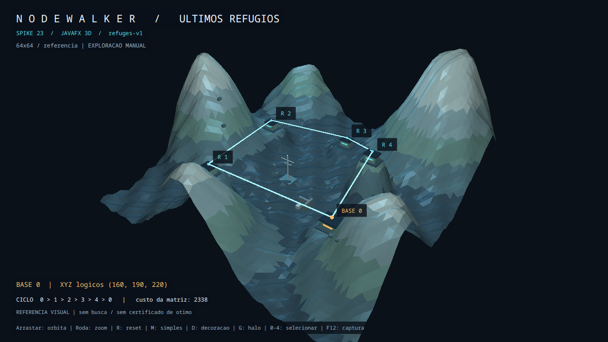
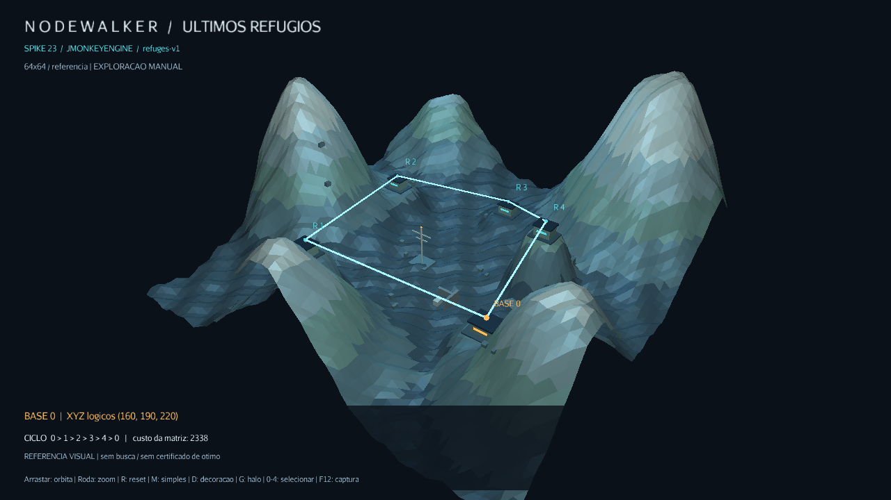
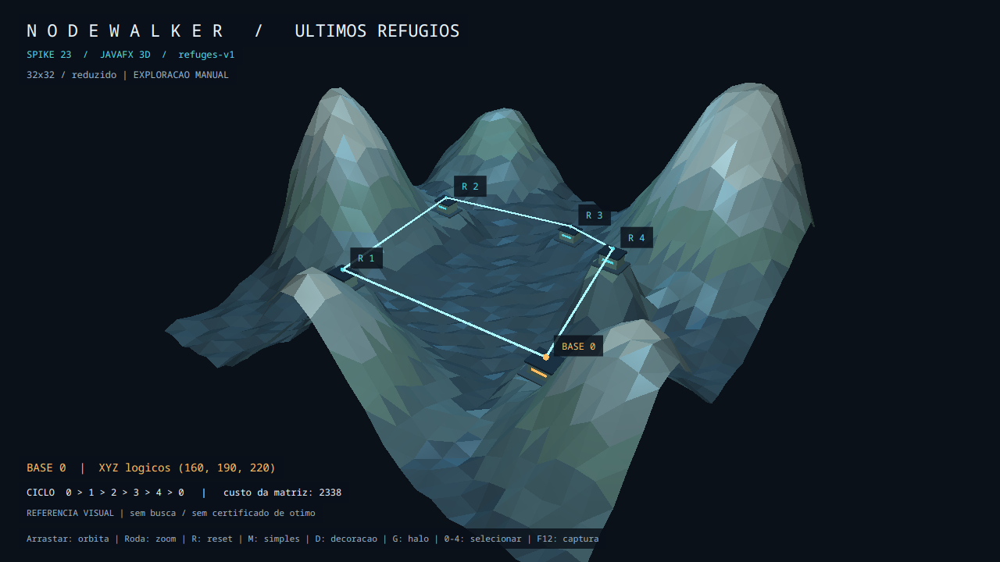

# Spike #23 — JavaFX 3D × jMonkeyEngine

Data: 17/10/2026. Referência: [issue #23](https://github.com/Nathan1227n/Nodewalker/issues/23).

**Recomendação provisória: JavaFX 3D estilizado para o MVP de 19/10.** A composição comum já produz relevo, refúgios e rota legíveis nos dois motores. A spike não demonstrou um ganho visual exclusivo do JME que compense uma segunda janela, outro ciclo de execução e a distribuição de bibliotecas nativas neste prazo. A decisão definitiva depende da revisão das capturas e da navegação pelo responsável pela demonstração. A [ADR 0001](ADR/0001-renderizador-3d.md) permanece pendente de aceite.

## Isolamento e reprodução

`spikes/renderer-comparison/` tem POM próprio, sem inclusão no reactor principal, sem dependência de `tsp-core` e sem alterações nos POMs de produção. `scene-common` contém apenas Java; os dois adaptadores têm janelas próprias. Não existe ponte JavaFX/JME, solver, geração assíncrona nem migração do aplicativo nesta spike.

Requisitos: Java 21, Maven, Python 3 para o coletor Linux, desktop com OpenGL. Dependências são resolvidas pelo Maven no build; os executáveis não fazem downloads. A geometria é procedural/autoral. Fontes e shaders básicos são os fornecidos pelas bibliotecas; não foram baixados modelos, texturas ou assets de terceiros em runtime.

Na raiz do repositório, compile **separadamente**:

```bash
mvn --batch-mode --no-transfer-progress -f spikes/renderer-comparison/pom.xml -pl javafx-prototype -am clean verify
mvn --batch-mode --no-transfer-progress -f spikes/renderer-comparison/pom.xml -pl jme-prototype -am clean verify
```

Os dois comandos executam os testes comuns; não somar esses testes duas vezes como cobertura distinta. Para somente os testes sem display:

```bash
env -u DISPLAY -u WAYLAND_DISPLAY mvn -f spikes/renderer-comparison/pom.xml -pl scene-common test
```

Abra um protótipo de cada vez, em um terminal da sessão Fedora:

```bash
python3 spikes/renderer-comparison/scripts/run.py javafx --output=/tmp/nodewalker-fx-manual
python3 spikes/renderer-comparison/scripts/run.py jme --output=/tmp/nodewalker-jme-manual
```

Cada diretório de saída deve ser novo: o coletor recusa sobrescrever uma observação. Feche a janela para concluir a coleta manual. Os arquivos de desenvolvimento sob `target/` não são versionados. Os executáveis podem ser iniciados diretamente, sem Python, depois do build:

```bash
java -Xms64m -Xmx512m -Dprism.vsync=true \
  -cp 'spikes/renderer-comparison/javafx-prototype/target/classes:spikes/renderer-comparison/javafx-prototype/target/dependency/*' \
  io.github.nathan1227n.nodewalker.spike.fx.FxLauncher --output=/tmp/nodewalker-fx-direto

java -Xms64m -Xmx512m \
  -cp 'spikes/renderer-comparison/jme-prototype/target/classes:spikes/renderer-comparison/jme-prototype/target/dependency/*' \
  io.github.nathan1227n.nodewalker.spike.jme.JmePrototype --output=/tmp/nodewalker-jme-direto
```

No Windows, o separador do classpath é `;`. Os scripts de RSS são destinados ao Linux; o CI Windows compila os adaptadores e executa os testes comuns, sem abrir janelas.

## Cena, câmera e matemática

A cena `refuges-v1` compartilha terreno analítico, materiais por faixa de altitude, objetos, posições, câmera, ciclo e matriz. Há cinco refúgios, base 0 âmbar e demais beacons ciano, antena, paredes em ruínas e pedras. O terreno normal tem 8192 triângulos, o reduzido 2048. Não há LOD dinâmico: a troca de resolução é explícita. Há iluminação ambiente e duas fontes pontuais frias; halo geométrico da rota é opcional e começa desligado. Névoa, bloom, sombras, PBR e shaders personalizados não foram implementados nem usados como vantagem na comparação.

| Índice | XYZ lógicos |
| --- | --- |
| 0 | (160, 190, 220) |
| 1 | (720, 240, 140) |
| 2 | (860, 170, 690) |
| 3 | (490, 120, 850) |
| 4 | (210, 270, 590) |

Matriz armazenada e imutável por API:

```text
  0 568 843 715 382
568   0 572 756 681
843 572   0 406 665
715 756 406   0 410
382 681 665 410   0
```

Ciclo de referência: `0 → 1 → 2 → 3 → 4 → 0`; custo da matriz: **2338**. Sua validade, fechamento, soma e correspondência com as distâncias lógicas arredondadas são testados. **Não há execução de solver nem afirmação de ótimo.** O texto da cena diz isso explicitamente. O número 23 é a fase determinística do terreno, não uma seed de geração de instância do núcleo.

Transformações, em escala unitária:

- JME: `(x,y,z) → (x−500, y, z−500)`; inversa `(u,v,w) → (u+500,v,w+500)`.
- JavaFX: `(x,y,z) → (x−500, −y, 500−z)`; inversa `(u,v,w) → (u+500,−v,500−w)`.

A rotação de 180° em X no JavaFX preserva a orientação da malha e evita espelhamento da câmera. Testes verificam inversa e preservação de comprimentos. Beacons e extremidades das arestas ficam exatamente nas posições transformadas dos pontos lógicos. Cabines e bases ficam abaixo dessas âncoras; o heightmap forma platôs ao redor delas. Esses ajustes decorativos não modificam XYZ, matriz ou ciclo.

A rota é formada por segmentos 3D diretos. Pode haver oclusão ou interseção com o relevo em determinados ângulos; ela não representa uma estrada na montanha. Seleção mostra as coordenadas originais. A issue #11 deverá consumir `TspProblem` e resultados reais, distinguindo explicitamente incumbentes interrompidas de resultados com garantia de ótimo.

Câmera compartilhada: FOV vertical 45°, alvo lógico `(500,100,500)`, raio inicial 1900, azimute −0,65 rad e elevação 0,60 rad. Zoom limitado a 650–3200; elevação limitada para evitar inversão. Benchmark: azimute inicial mais `0,10 × segundos`, sem depender da quantidade de callbacks.

## Controles e roteiro manual

| Entrada | Ação |
| --- | --- |
| Arrastar com botão esquerdo | Orbitar |
| Roda do mouse | Zoom |
| R | Reset da câmera |
| M | Alternar terreno reduzido e decoração |
| D | Ocultar/mostrar decoração |
| G | Alternar halo da rota |
| Clique no refúgio ou 0–4 | Selecionar e ler XYZ lógicos |
| F12 | Salvar PNG no diretório da execução |

Validar manualmente, para **cada** engine:

1. Identificar os cinco refúgios e base 0; seguir o ciclo e conferir retorno à origem.
2. Selecionar todos os refúgios pelo mouse e pelo teclado; conferir a tabela XYZ.
3. Orbitar, atingir limites de zoom, usar reset e conferir legibilidade/oclusões.
4. Alternar M/D/G; confirmar que posições e sequência da rota permanecem iguais.
5. Minimizar/restaurar, trocar foco, fechar e reabrir; registrar problemas de input, foco e encerramento.
6. Salvar capturas equivalentes e registrar avaliação de contraste, relevo e conforto da navegação.
7. Abrir o aplicativo original com `--2d`, testar alternância e documentar fallback em desktop sem Scene3D quando disponível.

Essas interações humanas não são substituídas pelos testes unitários ou por capturas automáticas. A seleção de origem começa em 0; o HUD experimental não representa o HUD completo da issue #12.

## Capturas e coleta

Para capturas reais do enquadramento fixo, com navegação bloqueada e fechamento automático:

```bash
python3 spikes/renderer-comparison/scripts/run.py javafx --capture-only --output=/tmp/nodewalker-fx-captura
python3 spikes/renderer-comparison/scripts/run.py jme --capture-only --output=/tmp/nodewalker-jme-captura
python3 spikes/renderer-comparison/scripts/run.py javafx --capture-only --simple --output=/tmp/nodewalker-fx-simples
python3 spikes/renderer-comparison/scripts/run.py jme --capture-only --simple --output=/tmp/nodewalker-jme-simples
```

A captura JavaFX usa snapshot da cena de uma janela realmente aberta; a do JME lê o framebuffer. Nenhuma imagem foi gerada por IA, recomposta ou usada como evidência de uma execução headless. Capturas isoladas não são medições de desempenho.

Para repetir a comparação normal:

```bash
python3 spikes/renderer-comparison/scripts/compare.py --output=/tmp/nodewalker-comparacao
python3 spikes/renderer-comparison/scripts/summarize.py /tmp/nodewalker-comparacao
```

O script executa três pares sequenciais, alternando a ordem: FX/JME, JME/FX, FX/JME. Cada processo faz 10 s de aquecimento e 60 s de órbita medida, com heap `-Xms64m -Xmx512m`. Duração total aproximada: sete minutos. Para uma série reduzida, acrescente `--simple`. Não minimize as janelas, interaja, capture imagens ou rode builds durante a medição; mantenha resolução, escala do desktop e monitor iguais.

Configuração comum: área de cena 1280×720, janela não redimensionável, MSAA desligado, VSync solicitado, nenhum limite adicional de FPS da aplicação, decoração normal e halo desligado. JavaFX usa Prism ES2/X11; JME prefere X11/XWayland e OpenGL 3.3, evitando comparar seu backend Wayland com X11 no primeiro motor. Fontes, métricas de texto e semântica interna de iluminação não são idênticas. O JME desabilita pausa por perda de foco da aplicação, mas isso não controla throttling do driver/compositor; foco e visibilidade são registrados para contextualizar esse risco.

Cada execução gera:

- `console.log`: versão, contexto gráfico e mensagens de inicialização.
- `summary.properties`: snapshot, configurações, método, mediana/p95/máximo dos intervalos, cadência de callbacks, pausas acima de 50/100 ms, inicialização e heap.
- `intervals.csv`: intervalos brutos em nanossegundos, após aquecimento.
- `rss.csv` e `process.json`: RSS a cada 250 ms, comando exato, PID, duração total e código de saída.
- `events.txt`: intervenções; uma medição com intervenção não é considerada benchmark inalterado. `unmodifiedBenchmark` significa ausência de comandos da cena; não certifica foco ou condições externas constantes.
- Foco, visibilidade e minimização: contagens por callback em `summary.properties`, incluindo aquecimento. São amostras, não proporções de tempo; uma janela marcada visível pelo toolkit pode estar encoberta por outra.
- PNG: quando solicitado por F12 ou `--capture-only`.

Percentis usam **nearest rank**. Um intervalo que cruza o fim da janela entra na amostra, para não esconder uma pausa final; a duração observada pode exceder 60 s. O primeiro intervalo que atravessa o fim do aquecimento é excluído. O coletor externo encerra uma JVM travada após aquecimento + duração + 30 s no benchmark, ou após 30 s no modo de captura; esse watchdog marca a execução como falha, nunca como evidência de sucesso. Encerramento precoce gera `samplingComplete=false` quando o encerramento é normal; falha abrupta pode deixar apenas logs/RSS, e o coletor retorna erro.

**Cadência não equivale a FPS apresentado.** JavaFX mede callbacks `AnimationTimer`; JME mede callbacks `simpleUpdate`. Ambos antecedem apresentação efetiva pela GPU/compositor. VSync solicitado não prova sua aplicação pelo driver. A meta inicial de 30 FPS permanece uma meta de experiência, não uma aprovação automática baseada nesses contadores. A frequência observada de callbacks do JavaFX pode superar o pulso nominal; não usar isso para afirmar superioridade de FPS.

Inicialização significa **início da JVM até primeiro callback da aplicação**, pelo uptime da JVM; exclui Maven, download e tempo anterior à JVM, e não comprova o instante do primeiro frame apresentado. São processos novos com caches de SO possivelmente aquecidos. Heap é amostrado uma vez por segundo no callback, incluindo aquecimento; RSS inclui memória nativa residente, mas **não é consumo de VRAM**. Picos entre amostras podem escapar. O pico RSS inclui inicialização e gravação dos resultados/encerramento; não é somente o estado estável de renderização. O cenário não roda solver.

## Ambiente e evidências

A primeira tentativa dentro do sandbox não acessou `:0`. A execução autorizada fora do sandbox abriu ambas as janelas, com renderização direta NVIDIA confirmada por `glxinfo -B` e pelos logs de cada engine.

- Fedora 44, sessão Wayland com XWayland; Linux `7.2.11-200.fc44.x86_64`.
- AMD Ryzen 7 5700X, 16 CPUs lógicas, aproximadamente 31 GiB de RAM.
- NVIDIA GeForce RTX 5060, driver 615.78.08, aproximadamente 8 GiB de VRAM informados pelo driver.
- Temurin 21.0.12.1, Maven 3.9.11; JavaFX 21.0.12; JME 3.9.0-stable; LWJGL 3.3.6.
- Monitor primário informado por GLFW: 1920×1080 a 180 Hz; viewport capturado de 1280×720, escala JavaFX 1×.
- Desktop de desenvolvimento compartilhado com IDE/agente; não é laboratório de desempenho. As observações valem para este equipamento e este cenário pequeno.

### Capturas reais e artefatos

As imagens abaixo são capturas dos próprios motores, em janelas abertas na RTX 5060. A coleta final desta retomada usa a mesma câmera, sem entrada de navegação durante a captura:

| JavaFX 3D | jMonkeyEngine |
| --- | --- |
|  |  |
|  |  |

Arquivos e metadados estão em [evidencias/spike-23](evidencias/spike-23/README.md). As primeiras capturas da sessão anterior ficaram em arquivos temporários removidos entre sessões; os valores dessas execuções não foram usados no comparativo final. O trabalho foi retomado para preservar os dados no workspace.

| Artefatos locais Linux após build | JavaFX | JME |
| --- | ---: | ---: |
| JAR do adaptador | 15.652 bytes | 16.054 bytes |
| Dependências runtime copiadas | 8.132.083 bytes (7.76 MiB) | 13.081.373 bytes (12.48 MiB) |
| Quantidade de JARs runtime | 9 | 47 |

Os totais incluem `scene-common`, bibliotecas e os classificadores nativos resolvidos por esses POMs neste Linux. JME inclui nativos para várias plataformas; essa distribuição ainda pode ser reduzida posteriormente. Não incluem a JVM, fontes do projeto, captura ou cache Maven completo. Inventários por arquivo acompanham as evidências. Esses números não são estimativas do pacote final de produção.

### Medições observadas — três pares

Todas as seis execuções terminaram normalmente, completaram a janela de amostragem e não receberam comandos interativos na cena. **As condições de foco diferiram; esta série é um registro operacional, não uma classificação de desempenho entre engines.** O JavaFX permaneceu focado nas amostras; o JME perdeu foco em parte delas e apresentou pausas próximas de um segundo. A relação causal não foi isolada. Repetir manualmente com a janela em primeiro plano antes de usar a cadência para avaliar fluidez.

| Rodada | Callbacks/s | Mediana / p95 (ms) | Max (ms) | >100 ms | JVM→callback (ms) | Heap / RSS (MiB) | Foco (callbacks) |
| --- | ---: | ---: | ---: | ---: | ---: | ---: | ---: |
| javafx-1 | 316.701 | 3.012 / 5.381 | 26.424 | 0 | 611 | 47.4 / 515.3 | 22019/22019 |
| javafx-2 | 319.555 | 2.975 / 5.331 | 24.607 | 0 | 578 | 47.4 / 520.8 | 22175/22175 |
| javafx-3 | 319.904 | 2.965 / 5.318 | 25.670 | 0 | 592 | 47.9 / 519.4 | 22283/22283 |
| jme-1 | 0.999 | 1000.652 / 1001.364 | 1002.689 | 60 | 610 | 20.8 / 200.1 | 219/288 |
| jme-2 | 30.688 | 5.569 / 6.642 | 1005.820 | 51 | 585 | 22.6 / 207.8 | 3609/3659 |
| jme-3 | 3.395 | 6.975 / 1001.159 | 1001.807 | 60 | 616 | 20.7 / 201.5 | 617/1998 |

Foco é apresentado como callbacks focados/observados, incluindo aquecimento, sem equivalência com proporção de tempo. RSS e heap são picos amostrados, com o escopo descrito acima. A diferença de atividade das janelas também impede concluir eficiência relativa de memória. FPS efetivamente apresentado pela GPU/compositor **permanece não medido**; a meta inicial de 30 FPS não foi certificada por esta coleta.

Dados por rodada: [tabela](evidencias/spike-23/benchmark-summary.md) e [arquivos brutos](evidencias/spike-23/README.md). Não foram substituídos valores discrepantes por estimativas ou removidas pausas para melhorar o resultado.

## Comparação técnica e risco para o MVP

| Critério | JavaFX 3D | jMonkeyEngine |
| --- | --- | --- |
| Visual no tempo da spike | Cena procedural fria, cinco refúgios e ciclo capturados | Mesma composição capturada; sem ganho exclusivo demonstrado neste preset |
| Terreno/material/iluminação | TriangleMesh + PhongMaterial; malha e faixas autorais | Mesh + Lighting/Unshaded; terreno especializado/LOD ainda não exercitado |
| Câmera e entrada | Órbita/zoom/reset e seleção implementados; revisão humana pendente | Mesmas operações implementadas; revisão humana pendente |
| FPS apresentado | Não instrumentado; callbacks disponíveis | Não instrumentado; callbacks disponíveis |
| Inicialização/memória | Medidas JVM/heap/RSS, escopo descrito acima | Mesmas medidas; bibliotecas nativas entram no RSS |
| HUD e seleção | Controls/labels e eventos já compatíveis com o app atual | BitmapText, GUI node e ray picking; HUD completo exigiria adaptação |
| Java 21/Maven/Fedora | Compilação e janela verificadas | Compilação e janela verificadas; LWJGL/nativos adicionais |
| Falta de suporte gráfico | Detecta falta de Scene3D e orienta a usar app original 2D | Falha do contexto deve retornar ao app JavaFX; ponte automática ainda não implementada |
| Integração com JavaFX | Reaproveita o toolkit/ciclo existente na futura #11 | Janela independente comprovada; embedding e ponte de eventos não testados |
| Dependências/distribuição | OpenJFX e swing apenas para capturas da spike | Core/desktop/LWJGL3 e nativos multiplataforma; plugins de modelos excluídos |
| Manutenção | Migração futura menor; terreno e câmera continuam autorais | APIs gráficas mais amplas, mas segundo ciclo e estratégia de fallback a manter |
| glTF/GLB futuro | Importador/conversão adicional a selecionar e validar | Loaders documentados em jme3-plugins; não incluídos nem exercitados aqui |
| #11/#12 e prazo | Menor mudança arquitetural para a base existente | Custo adicional de janela, comunicação, distribuição e fallback |

A documentação oficial do JME recomenda glTF para o pipeline de modelos. Isso sustenta uma possibilidade futura, não uma importação validada nesta spike: [pipeline do SDK](https://wiki.jmonkeyengine.org/docs/3.9/sdk/model_loader_and_viewer.html). A base mínima usada segue o [Quick Start](https://jmonkeyengine.org/start/). Para JavaFX, as APIs usadas são [TriangleMesh](https://openjfx.io/javadoc/21/javafx.graphics/javafx/scene/shape/TriangleMesh.html), [PhongMaterial](https://openjfx.io/javadoc/21/javafx.graphics/javafx/scene/paint/PhongMaterial.html) e [AnimationTimer](https://openjfx.io/javadoc/21/javafx.graphics/javafx/animation/AnimationTimer.html).

A coleta exploratória no desktop compartilhado observou intervalos próximos de um segundo no JME e mudanças de cadência entre rodadas. A causa não foi isolada; não atribuir automaticamente esses intervalos ao custo da malha ou ao motor. A implementação de `setPauseOnLostFocus(false)` foi conferida na biblioteca e corresponde a `LostFocusBehavior.Disabled`. Ainda podem existir efeitos externos de foco, oclusão, VSync ou compositor. A série final registra os estados observados, e a repetição manual em primeiro plano continua necessária antes de comparar desempenho percebido.

O JME registra avisos sobre loaders opcionais ausentes (glTF/Ogre/FBX/OGG), pois a configuração padrão os menciona e esses módulos não foram incluídos. A cena procedural abre sem eles. Um ensaio inicial com backend Wayland também registrou aviso de libdecor; o preset comparativo prefere X11. JavaFX por classpath registra o aviso de classes em módulo não nomeado; esse empacotamento simples serve à spike, não resolve a distribuição final com runtime modular.

Estimativas de engenharia **provisórias**, para um desenvolvedor e reaproveitamento conceitual da spike; não são medições nem compromisso de prazo:

| Caminho | Issue #11 | Issue #12 | Premissas |
| --- | --- | --- | --- |
| JavaFX estilizado | 6–10 h | 8–12 h | Adaptar instâncias reais, 2D fiel, câmera, estados e controles assíncronos no toolkit existente |
| JME em janela separada + JavaFX | 10–16 h | 12–20 h | Acrescentar transporte de snapshots/eventos, lifecycle das duas janelas, fallback e distribuição |

Essas faixas não incluem homologação completa da #13/Windows, retrabalho após avaliação visual, assets externos ou embedding de JME. Com MVP em 19/10, reservar revisão e teste gráfico e cortar efeitos antes de comprometer cancelamento, limites, legibilidade ou 2D. Se houver interesse posterior no JME, propor uma nova PR incremental após decisão e revisão; esta PR não inicia migração.

## Fallback e limites da validação

`NodeWalkerApp`, `DemoPreview`, `PreviewModeSelector`, CSS e POMs de produção permanecem idênticos à main de base. O aplicativo atual ainda é a demonstração G0; o cenário da spike não foi instalado nela. Os quatro testes de seleção 3D/2D continuam presentes. O build principal permanece independente dos novos artefatos.

Para a verificação manual do app original, após instalar o reactor:

```bash
mvn clean install
mvn -f tsp-app/pom.xml javafx:run -Djavafx.args=--2d
```

Em um desktop sem Scene3D, testar também o início sem `--2d`, o botão 3D desabilitado e legibilidade do 2D. **Sem servidor gráfico, nem o fallback 2D abre uma janela.** Nesse ambiente, execute somente builds/testes headless; não force uma GPU inexistente para produzir suposta evidência.

- `mvn clean verify` do produto: **1781 testes**, zero falhas/erros/ignorados; aproximadamente **7,3 s** nesta retomada.
- Build isolado JavaFX: **BUILD SUCCESS**, aproximadamente **2.9 s**; build isolado JME: **BUILD SUCCESS**, aproximadamente **2.4 s** (caches de dependências aquecidos).
- **20 testes distintos** em `scene-common`: snapshot imutável, matriz/ciclo, beacons nas âncoras, terreno determinístico/normais, inversas e comprimentos, câmera/reset/limites e coleta com relógios sintéticos (incluindo origem negativa e pausa final). Nenhum usa display, `Thread.sleep` ou desempenho da máquina como condição de sucesso.
- Sintaxe dos scripts Python verificada; `git diff --check` e comparação dos caminhos de produção com a main de base aprovados.
- CI: a matriz Ubuntu/Windows mantém o build principal e acrescenta uma etapa separada de compilação/testes da spike. Resultados da PR devem ser consultados nos checks; nenhum job abre janela.

Aceite definitivo ainda requer avaliação humana de seleção, zoom/órbita/reset, foco, legibilidade nos ângulos extremos e fallback real. CI Ubuntu/Windows comprova compilação/testes, não qualidade visual nem execução de janela no Windows. A spike está limitada à composição pequena, malhas estáticas e recursos básicos; não avalia N grande, concorrência com solver, HUD completo, pipelines PBR/glTF ou distribuição final.
