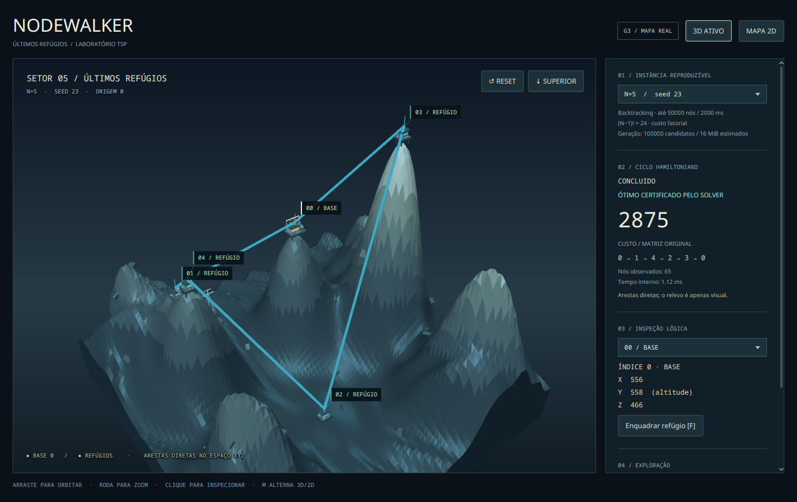
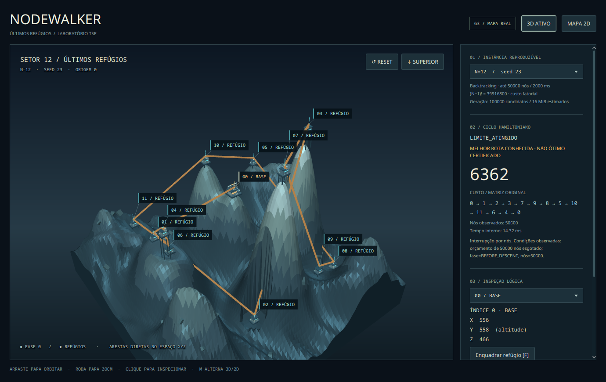

# Evidências gráficas — issue #11

**Registro histórico da primeira implementação.** A [galeria do refinamento na mesma PR #34](refinamento/README.md) mostra a paisagem ampliada, novas arquiteturas, rótulos e apresentação de estados; as imagens abaixo não foram substituídas.

Coletadas em 17/10/2026 (America/Fortaleza), em janela real Fedora 44 / Wayland, RTX 5060 e driver NVIDIA 615.78.08, Java 21.0.12.1. Scene 1380×870; viewport padrão 1008×717. PNGs são snapshots JavaFX da janela visível, sem edição. [SHA256SUMS](SHA256SUMS) registra os arquivos. Não são imagens geradas por IA nem evidência de FPS apresentado.

| Captura | Conteúdo |
| --- | --- |
| [Topo e seleção](02-n5-top-selection.png) | Seleção do índice 2 e ciclo real, câmera superior |
| [Mapa 2D](03-n5-map2d.png) | Mesma instância/rota/seleção em XZ, Y lógico indicado |
| [Simplificação](04-n5-simplified.png) | Malha reduzida e decoração desativada |
| [BASE 0](05-n5-base-detail.png) | Terminal âmbar, pórtico e arquitetura autoral |
| [N=3](06-n3.png) | Seed 23, CONCLUIDO, custo 1828 |
| [N=8](07-n8.png) | Seed 657, CONCLUIDO, custo 3574 |
| [Fallback automático](09-automatic-fallback.png) | Prism software, sem `--2d`, Scene3D indisponível e botão 3D desabilitado |

Dados: [manifesto principal](manifest.tsv), [ambiente](environment.json), [saída do roteiro](review-output.txt), [manifesto de fallback](fallback-manifest.tsv), [ambiente de fallback](fallback-environment.json). Os tempos internos do solver mostrados nas imagens variam; nós/rotas/custos estão no manifesto. Não interpretar esses tempos como desempenho gráfico.

Reprodução e limites: [VISUALIZACAO_TSP.md](../../VISUALIZACAO_TSP.md). Os handlers de câmera foram exercitados com eventos sintéticos e os demais controles por API; a tentativa adicional com Robot não comprovou entrada nativa no Wayland. No depurador: `stage.isFocused()==false`, câmera inalterada e nenhum evento de arrasto no handler. Por isso conforto, mouse/teclado humanos e homologação Windows continuam pendentes. Esta galeria não certifica aprovação artística ou usabilidade pelo responsável.
