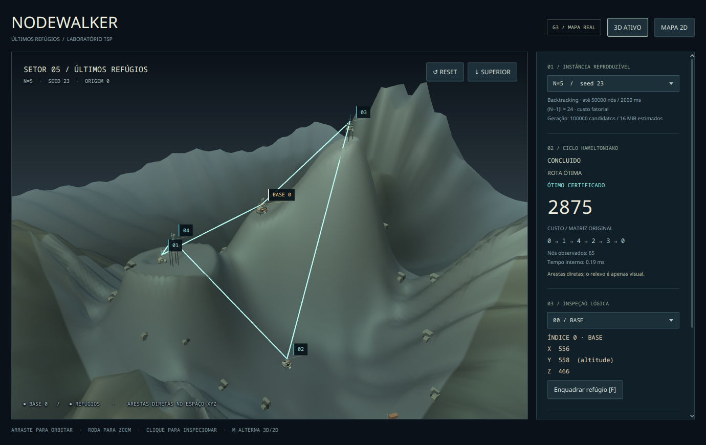
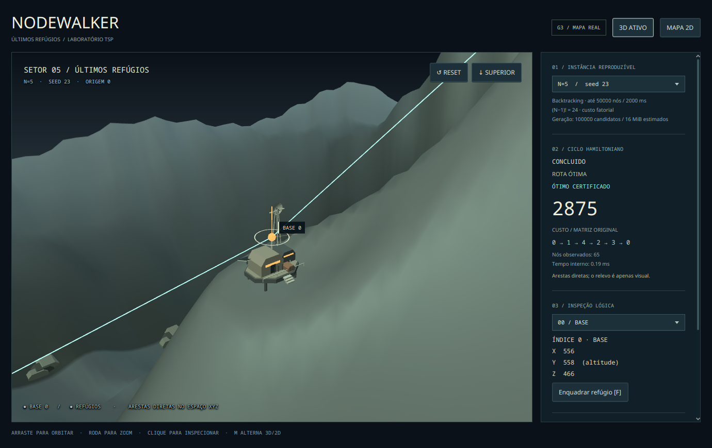
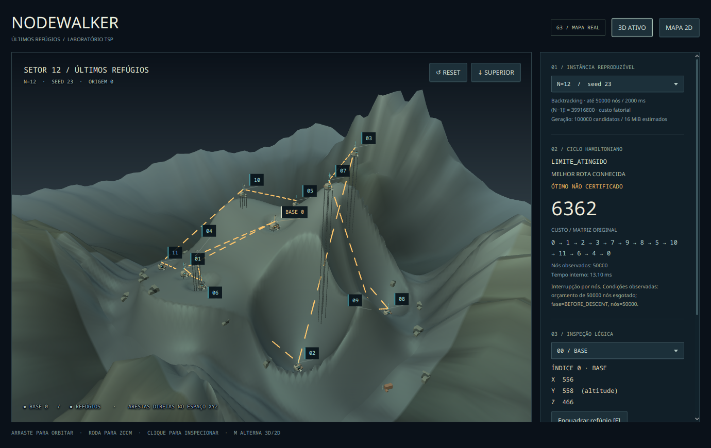

# Refinamento visual da #11 — janela real Fedora

**Rodada histórica anterior à correção de textura.** A [galeria atual de superfície fosca e atmosfera mais escura](../texturas/README.md) preserva a comparação, sem substituir estes PNGs.

Coleta em **17/10/2026, 22:55–22:59 America/Fortaleza**, na branch `feat/g3-real-tsp-world`, continuação da PR #34. Os PNG são snapshots sem edição da Scene visível, produzidos pela composição de produção. [SHA256SUMS](SHA256SUMS) identifica os arquivos. A [primeira rodada da #11](../README.md) permanece preservada para comparação histórica.

Fedora 44 / kernel 7.2.11, Wayland/Xwayland, RTX 5060 / driver NVIDIA 615.78.08, Temurin 21.0.12.1, JavaFX 21.0.12. Scene **1380×870**, viewport padrão **1008×717**. [Ambiente/driver](desktop/environment.json), [execução gráfica](desktop/review-output.txt), [manifesto](desktop/manifest.tsv), [recursos](desktop/resources.tsv).

## Paisagem e arquitetura

N=5, seed 23: resultado real de backtracking limitado, CONCLUIDO, custo **2875**, rota `[0,1,4,2,3,0]`. Região contínua e dessaturada, marcadores lógicos preservados, labels compactos.



Terminal BASE 0: comando modular, ala técnica, torre/radar, painéis, gerador e plataforma. Captura obtida por foco na seleção; não há deslocamento da cidade para aproximar a estrutura.



Três variantes secundárias: [comunicação](desktop/variant-1.png), [manutenção/suprimentos](desktop/variant-2.png), [monitoramento](desktop/variant-3.png). Plataformas podem usar pilares altos quando a altitude lógica fica acima do relevo ou de um vizinho em XZ; o ponto da rota continua exatamente na coordenada transformada.

Outras vistas reais: [topo e seleção](desktop/02-n5-top-selection.png), [mapa XZ/altitude](desktop/03-n5-map2d.png), [simplificação sem decoração](desktop/04-n5-simplified.png), [N=3/seed 23](desktop/06-n3.png), [N=8/seed 657](desktop/07-n8.png).

## Incumbente real e rótulos

N=12, seed 23: **LIMITE_ATINGIDO**, 50000 nós, incumbente de custo **6362**, rota `[0,1,2,3,7,9,8,5,10,11,6,4,0]`. Não há prova de ótimo. O painel mostra título e **ÓTIMO NÃO CERTIFICADO** em linhas distintas; a frase negativa não quebra. A rota âmbar tem lacunas reais entre os traços. As arestas são diretas no espaço e podem atravessar relevo; não são estradas sobre a superfície.



[Modo de exploração limpa](desktop/09-n12-clean-labels.png): rótulos reduzidos a BASE 0 e selecionado. Alocação normal usa prioridade explícita e omite secundários sem espaço. A lista lateral conserva acesso a todos os N refúgios. A coleta verifica bounds/colisões dos Labels efetivamente renderizados, além dos testes headless do algoritmo.

## Fixtures de apresentação dos estados

Os arquivos `state-fixture-*` usam resultados construídos pelas fábricas validadas do núcleo, com motivo **FIXTURE DE APRESENTAÇÃO**. Demonstram a UI recebendo cada estado, não uma alegação de cancelamento/erro real na execução do solver desta coleta. O caso N=12 acima é a interrupção real por orçamento. Nos fixtures sem métricas, a UI mostra “não informado”; `-1` no manifesto é somente marcador de ausência no arquivo de coleta.

| Estado | Com incumbente | Sem incumbente |
| --- | --- | --- |
| CONCLUIDO | [Rota certificada](desktop/11-state-fixture-CONCLUIDO-route.png) — resultado real N=5 | Não aplicável ao contrato |
| CANCELADO | [Melhor rota conhecida, não certificada](desktop/12-state-fixture-CANCELADO-route.png) | [Sem rota](desktop/13-state-fixture-CANCELADO-none.png) |
| LIMITE_ATINGIDO | [Melhor rota conhecida, não certificada](desktop/14-state-fixture-LIMITE_ATINGIDO-route.png) | [Sem rota](desktop/15-state-fixture-LIMITE_ATINGIDO-none.png) |
| ERRO | [Melhor rota conhecida, não certificada](desktop/16-state-fixture-ERRO-route.png) | [Sem rota e custo não informado](desktop/17-state-fixture-ERRO-none.png) |

O roteiro alterna 3D/2D em cada fixture e confere a mesma identidade de modelo, status e texto de certificação. Depois restaura o resultado real N=5 antes de inspecionar as variantes.

## Recursos e limites da observação

| Cena | Nodes no viewport | Materiais | Teto de triângulos incluindo primitivas | Buffers numéricos + mapa tonal |
| --- | --- | --- | --- | --- |
| N=5 normal | 79 | 12 | 24308 | 1338320 B |
| N=5 simplificado, decoração oculta | 74 | 11 | 6196 | 396304 B |
| N=8 normal | 113 | 12 | 27116 | 1449104 B |
| N=12 parcial | 254 | 11 | 33492 | 1571888 B |
| Canvas 2D | 4 | 0 | 0 | O arquivo informa os dados preparados, não buffers GPU ativos |

Orçamentos de N≤12: 800 Nodes no viewport, 20 materiais, 50000 triângulos, 32 sítios decorativos e 32 MiB de buffers próprios por qualidade. São verificações da coleta e dos dados preparados, não limites globais do produto ou da JVM. Sphere/Cylinder usam um teto conservador; o painel lateral não entra na contagem de Nodes.

Em 21 snapshots/transições, heap usado foi **67–439 MiB**, RSS **406252–777112 KiB**. São amostras pontuais, sem GC ou aquecimento controlado, durante múltiplas reconstruções e capturas completas. Snapshots, JavaFX, listas/records, segunda qualidade, cópias nativas e driver não estão incluídos no orçamento de buffers próprios. Não inferir memória estabilizada ou ausência de vazamento desses poucos segundos. Nenhum travamento foi observado nesse roteiro curto; ele não substitui uma sessão prolongada.

Não há medição de frames apresentados, mediana/p95 ou validação de 30 FPS. Barreiras de pulsos sincronizam capturas, não contam apresentações da GPU. A aparência foi inspecionada nas imagens; conforto de entrada humana continua pendente. O teste por Robot da primeira rodada foi inconclusivo no Wayland: não é relatado como sucesso de entrada nativa.

## Fallback e reprodução

Prism software, **sem SCENE3D**: [ambiente automático](software-auto/environment.json), [log](software-auto/review-output.txt), [manifesto](software-auto/manifest.tsv), [N=5](software-auto/01-n5-software2d.png), [N=12 parcial](software-auto/04-n12-software2d.png). Botão 3D desabilitado, nenhuma SubScene, seleção/XYZ/rota preservados. O [roteiro forçado --2d](software-forced/manifest.tsv) também passou nos quatro presets; seus logs/ambiente estão na mesma pasta. Os screenshots duplicados desse segundo roteiro não foram versionados.

Na raiz, JDK 21, Maven 3.9+, Python 3 e desktop Fedora com display acessível:

```bash
mvn clean install
mvn -f tsp-app/pom.xml javafx:run
mvn -f tsp-app/pom.xml javafx:run -Djavafx.args="--demo=12"
mvn -f tsp-app/pom.xml javafx:run -Djavafx.args="--2d --demo=8"
python3 tools/review_world.py --output tsp-app/target/refinement-review
python3 tools/review_world.py --software-auto --output tsp-app/target/refinement-fallback
python3 tools/review_world.py --software-2d --output tsp-app/target/refinement-forced2d
```

Para revisão humana: orbitar nos dois eixos, roda até os limites, R/reset, T/topo, selecionar em cena/lista, F/foco, M/alternância mantendo seleção, D/decoração, S/simplificação e rótulos reduzidos. Conferir N=8/12, aproximação, resize e coordenadas lógicas. Registrar resolução/hardware, legibilidade, travamentos e conforto. Janela real Windows, notebook/GPU fraca, sessão prolongada e aceite artístico final permanecem pendentes em #13/#17; CI headless não substitui essas verificações.
