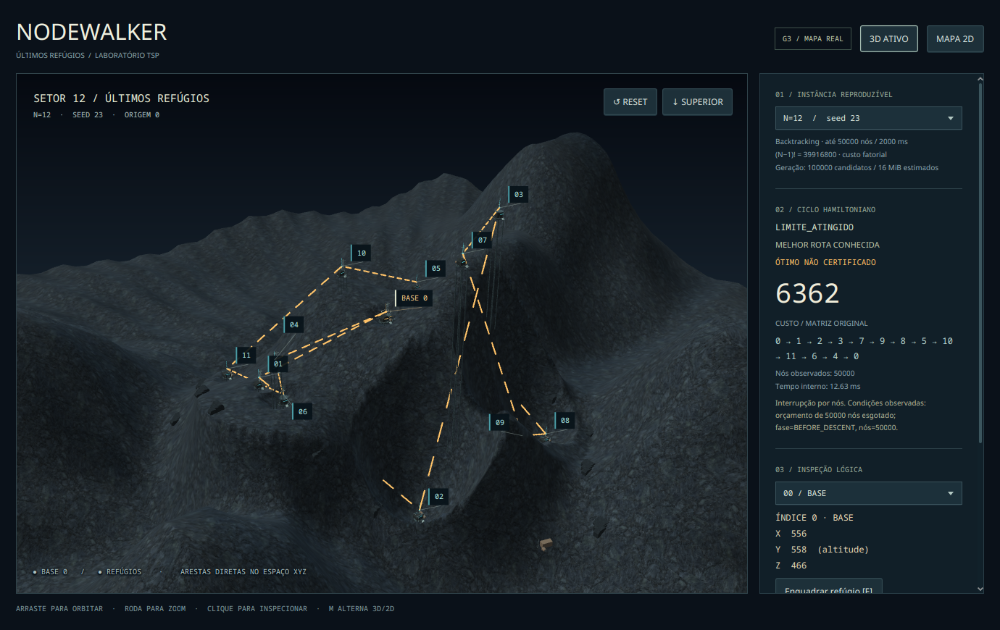
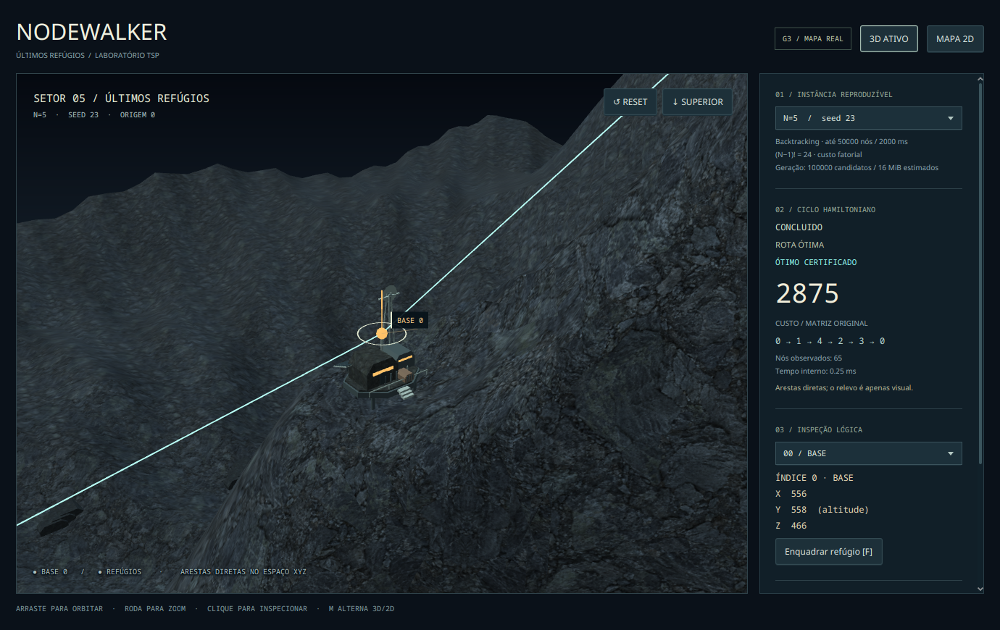

# Superfície rochosa e atmosfera sombria — captura real

17/10/2026, aproximadamente 23:09–23:10 America/Fortaleza, Fedora 44 / Wayland, RTX 5060 / NVIDIA 615.78.08, Java 21.0.12.1, JavaFX 21.0.12. Scene 1380×870. PNGs sem edição, da janela real; não são imagens geradas de como a aplicação poderia parecer. Somente o asset de superfície foi gerado por IA. [Origem, prompt e correção técnica](../../../TEXTURAS.md).





Outras capturas: [N=5 geral](desktop/01-n5-overview.png), [N=8/seed 657](desktop/07-n8.png), [modo simplificado sem decoração](desktop/04-n5-simplified.png), [Canvas 2D](desktop/03-n5-map2d.png), [fallback por software N=12 sem Scene3D](software/04-n12-software2d.png).

O [manifesto desktop](desktop/manifest.tsv), [log](desktop/review-output.txt), [ambiente](desktop/environment.json) e [recursos](desktop/resources.tsv) registram o roteiro completo de 21 snapshots/transições; apenas seis PNGs representativos foram versionados. O [manifesto software](software/manifest.tsv) registra N=3/5/8/12 sem SubScene, com botão 3D desabilitado. [Hashes dos sete PNGs preservados](SHA256SUMS).

| N / seed | Estado real | Custo | Nós |
| --- | --- | --- | --- |
| 3 / 23 | CONCLUIDO | 1828 | 5 |
| 5 / 23 | CONCLUIDO | 2875 | 65 |
| 8 / 657 | CONCLUIDO | 3574 | 7151 |
| 12 / 23 | LIMITE_ATINGIDO, ótimo não certificado | 6362 | 50000 |

As referências de estados `state-fixture-*` no manifesto são fixtures de apresentação validadas, com motivo explícito, como na [rodada anterior](../refinamento/README.md). Não são alegações de cancelamento/erro real ocorrido nesta busca.

N=12 mantém **254 Nodes**, **11 materiais** e teto estimado de **33492 triângulos** no viewport. Buffers próprios + imagem decodificada: **6221320 B**, abaixo de 32 MiB; a textura é compartilhada. N=5: **5880040 B**; simplificado: **4565032 B**. A conta foi atualizada para UVs por face e albedo de 1024²; não inclui listas/records, todas as cópias nativas, mipmaps, toolkit, driver ou snapshots.

Heap usado nas amostras desktop **99–476 MiB**; RSS **413388–846176 KiB**. Sem aquecimento/GC controlado, com repetidos snapshots e reconstruções; isso não mede memória estabilizada, ausência de vazamento ou o custo isolado da textura. Nenhum FPS apresentado ou mediana/p95 foi medido. Navegação humana, janela Windows e hardware fraco continuam pendentes de homologação; CI headless comprova build/testes.

Reprodução:

```bash
mvn clean install
mvn -f tsp-app/pom.xml javafx:run -Djavafx.args="--demo=12"
python3 tools/review_world.py --output tsp-app/target/texture-review
python3 tools/review_world.py --software-auto --output tsp-app/target/texture-fallback
```

Foca-se a seleção com F; R retorna ao enquadramento geral; T mostra o topo; M alterna 3D/2D. A rota continua exatamente a recebida de `TspResult`; textura, iluminação e câmera não alteram os custos nem deslocam cidades.
