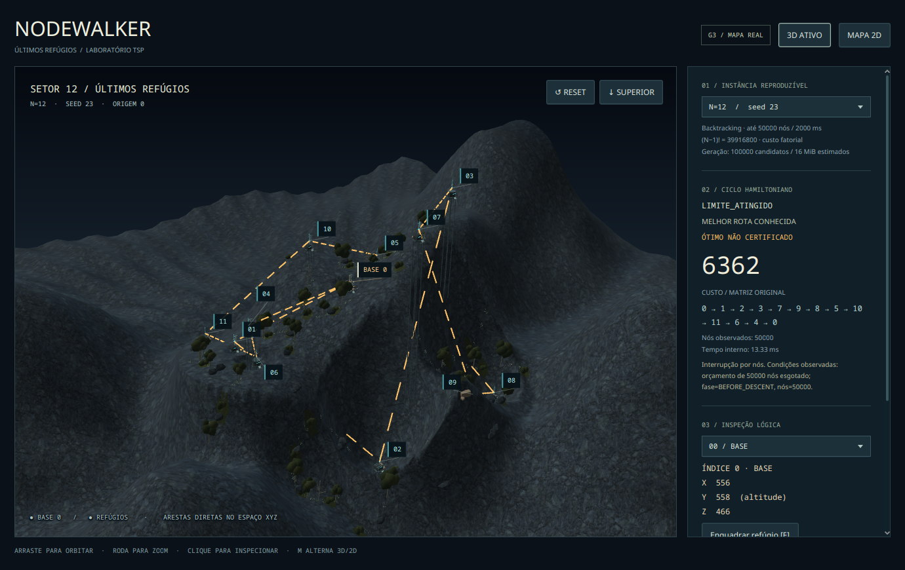
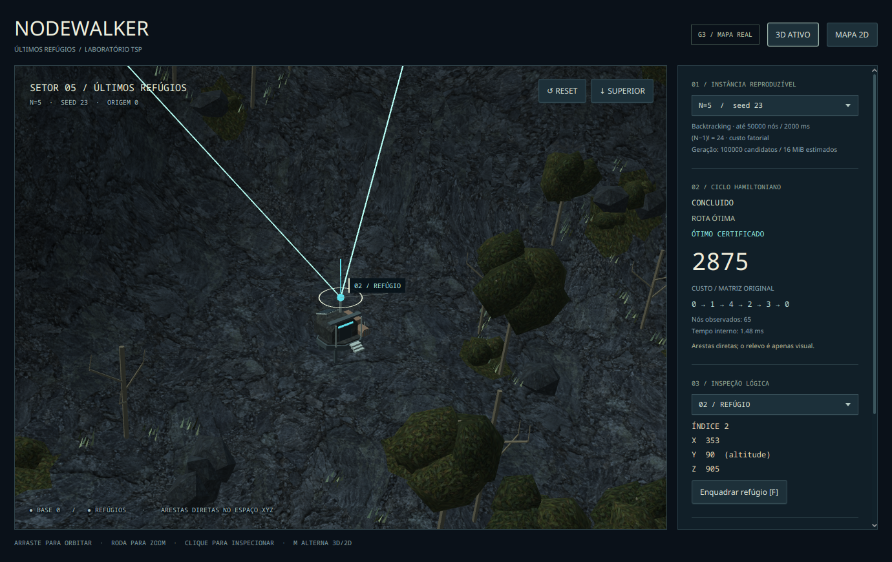

# Cena sombria com vegetação — evidência real

18/10/2026, aproximadamente 10:21 America/Fortaleza, Fedora 44 / Wayland, RTX 5060 / driver NVIDIA 615.78.08, Java 21.0.12.1 e JavaFX 21.0.12. Scene 1380×870; viewport 1008×717. Capturas sem edição da janela real. As duas texturas de material foram geradas por IA; **as cenas abaixo são renderizadas pelo aplicativo**, não mockups. [Origem, prompts e hashes dos assets](../../../TEXTURAS.md).





[N=8/seed 657](desktop/07-n8.png) · [Simplificado, decoração oculta](desktop/04-n5-simplified.png) · [Mapa 2D](desktop/03-n5-map2d.png) · [Fallback por software sem Scene3D](software/04-n12-software2d.png).

O [manifesto desktop](desktop/manifest.tsv), [recursos](desktop/resources.tsv), [ambiente](desktop/environment.json) e [log](desktop/review-output.txt) registram o roteiro de 21 snapshots/transições. Cinco PNGs desktop foram selecionados, além de um do [roteiro software](software/manifest.tsv); [hashes](SHA256SUMS). Dados de estados `state-fixture-*` no manifesto continuam sendo fixtures de apresentação claramente identificadas. Não são evidência de falha/cancelamento real nesta execução.

## Casos reais e recursos

| N / seed | Estado do solver | Custo | Nós | Elementos de vegetação preparados |
| --- | --- | --- | --- | --- |
| 3 / 23 | CONCLUIDO | 1828 | 5 | 333 |
| 5 / 23 | CONCLUIDO | 2875 | 65 | 271 |
| 8 / 657 | CONCLUIDO | 3574 | 7151 | 284 |
| 12 / 23 | LIMITE_ATINGIDO, sem prova de ótimo | 6362 | 50000 | 224 |

Em N=12: 26 árvores vivas, 8 troncos mortos, 40 arbustos, 129 tufos de capim e 21 rochas vegetativas. São decoração, sem índices de cidade e sem interferência nos custos. A origem e os N pontos TSP continuam exatamente os mesmos. No modo simplificado N=5 há 44 elementos preparados, contra 271 detalhados; a captura sem decoração os oculta. As contagens no TSV descrevem dados preparados, inclusive quando ocultos, não número de Nodes ativos.

N=12 usa **260 Nodes de viewport**, **17 materiais**, teto estimado de **44213 triângulos** e **7980092 B** de buffers próprios + texturas decodificadas. N=5: 84 Nodes, 18 materiais, 37474 triângulos e 7811792 B; simplificado sem decoração: 78 Nodes, 16 materiais e 7214 triângulos. Os orçamentos de 800 Nodes, 20 materiais, 50000 triângulos e 32 MiB continuam atendidos no catálogo.

Heap pontual da coleta desktop: **87–453 MiB**; RSS **442864–795708 KiB**. Não são limites de JVM nem memória estabilizada: há snapshots completos, carregamentos e trocas de renderer, sem aquecimento/GC controlado. Não foi medido FPS apresentado ou p95; isso não demonstra desempenho sustentado. A aparência foi inspecionada nas capturas; navegação humana, notebook/GPU fraca e janela real Windows continuam pendentes.

## Reprodução

Fechar a janela antiga antes de executar a versão recompilada:

```bash
mvn clean install
mvn -f tsp-app/pom.xml javafx:run -Djavafx.args="--demo=12"
python3 tools/review_world.py --output tsp-app/target/biome-review
python3 tools/review_world.py --software-auto --output tsp-app/target/biome-fallback
```

**D** oculta/mostra vegetação, rochas e ruínas; **S** simplifica; **F** foca a seleção; **R** enquadra a instância; **T** mostra o topo; **M** alterna 3D/2D. Árvores e relevo podem ocultar partes do mapa por perspectiva; usar órbita, D ou 2D permite inspecionar sem deslocar as cidades. Não há efeitos animados ou geração de plantas por frame.
