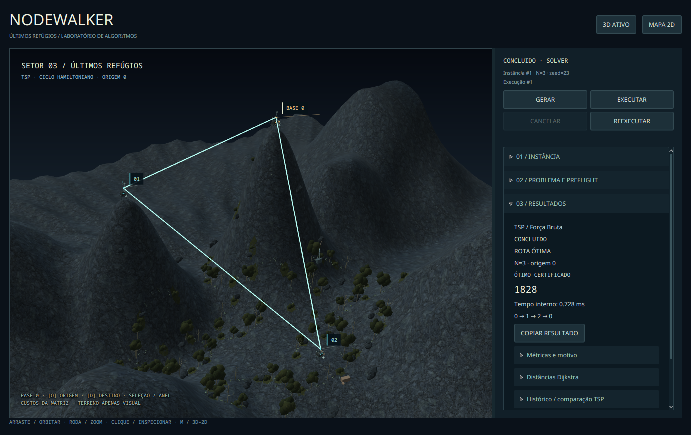
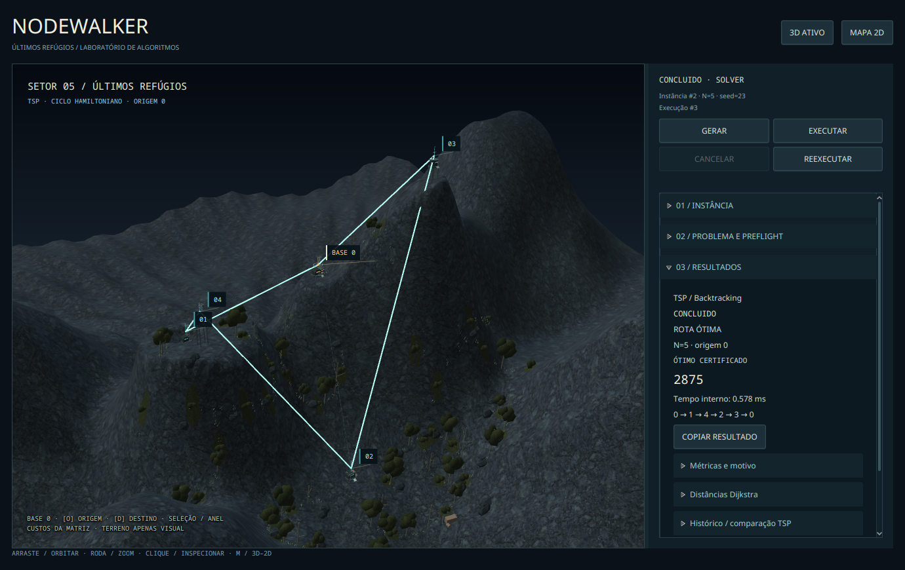
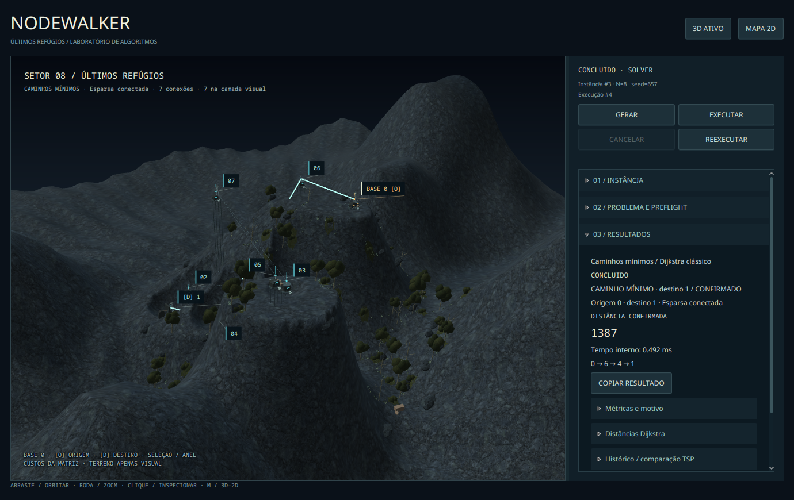
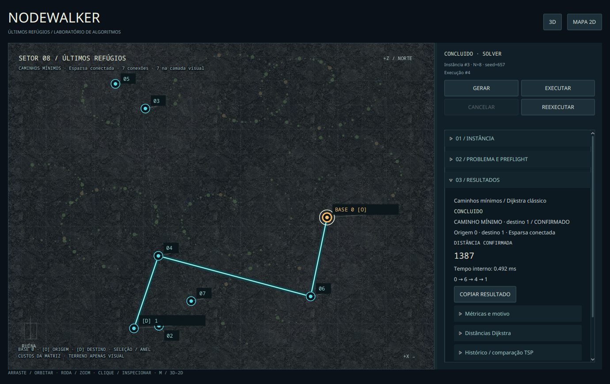
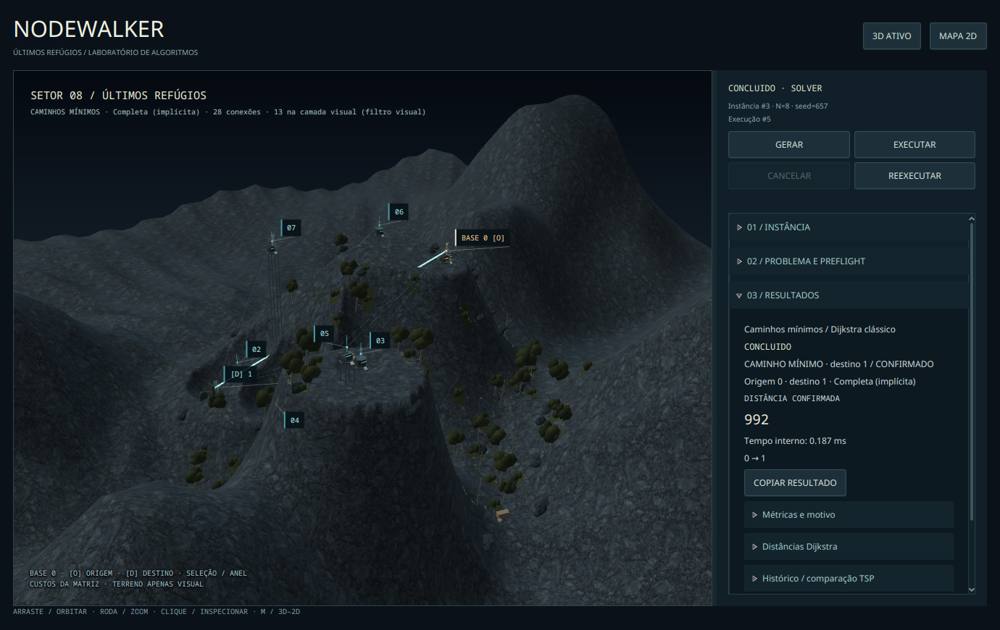
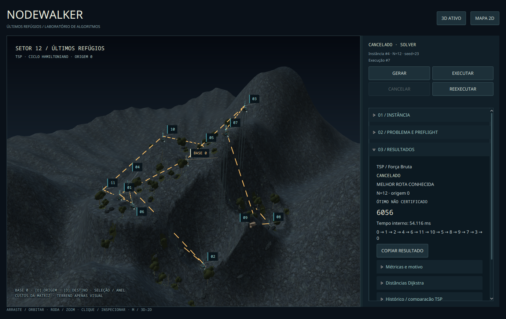
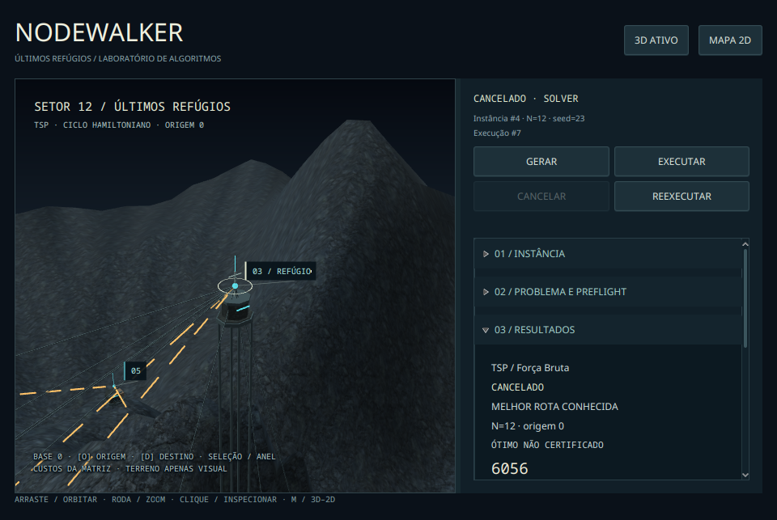

[Correções da revisão da PR #36: transições e cancelamento — 20/10/2026](transicoes/README.md).

[Apresentação dos resultados e comparação lado a lado — 20/10/2026](resultados/README.md).

# Evidências — painel operacional / issue #12

**Versão atual:** [HUD simplificado e animação gradual](simplificacao/README.md).
A primeira versão operacional abaixo fica preservada como histórico da revisão.

19/10/2026, Fedora 44, Wayland/Xwayland, Java 21.0.12.1, JavaFX 21.0.12,
NVIDIA RTX 5060 / driver 615.78.08. [Ambiente desktop](desktop/environment.json).
PNG são snapshots **sem edição da aplicação real**, não mockups. As texturas históricas
continuam sendo assets documentados na PR #34.

## Método e resultados

`tools/review_world.py --operational` usa a composição de produção, controles JavaFX por API,
gerador e algoritmos reais. Não injeta resultados de solver. É automação em janela real;
**não é operação manual humana**, entrada nativa comprovada ou medição de FPS.

[Manifesto desktop](desktop/operational-manifest.tsv) · [execução](desktop/review-output.txt)
· [2D forçado](forced-2d/operational-manifest.tsv) · [fallback automático](fallback/operational-manifest.tsv).

| Caso real | Resultado |
| --- | --- |
| N=3 / seed23 / Força Bruta e Backtracking | Mesma matriz, custo 1828 e ciclo 0→1→2→0 |
| N=5 / seed23 / Backtracking | Custo 2875; 0→1→4→2→3→0 |
| N=8 / seed657 / Dijkstra esparso, seed23, extras0 | Distância 1387; 0→6→4→1 |
| Mesma instância / Dijkstra completo | Distância 992; 0→1 |
| Mesma topologia completa / origem2 | Distância 125; 2→1 |
| Troca somente do destino | Mesmos runId, resultado, PreparedWorld e SubScene verificados pelo roteiro |
| N=12 / seed23 / cancelar Força Bruta durante trabalho | CANCELADO com ciclo incumbente real; sem certificação de ótimo |
| Reexecutar e fechar durante busca | Encerramento sem aguardar solver na thread FX |
| Janela 960×680, simplificação, seleção/foco | Captura da operação real abaixo |

Custo da incumbente cancelada e tempos dependem do instante do cancelamento; não são
referências de ótimo nem benchmark. Os manifestos registram os valores observados.

## Regressão e limitações

O [roteiro histórico adaptado](regressao/review-output.txt) também passou: presets N=3/5/8/12,
3D/2D, seleção, câmera por eventos sintéticos, descarte de SubScene e atualizações sem
reconstrução de terreno. Suas imagens `state-fixture-*` são **fixtures de apresentação**,
conforme o [manifesto](regressao/manifest.tsv), e não cancelamentos matemáticos reais.
As imagens operacionais acima não usam essas fixtures.

A [tentativa de entrada nativa por Robot](native-attempt/review-output.txt) falhou no arrasto
orbital: câmera não mudou. A mesma limitação já estava registrada para Wayland na #11.
Não há evidência suficiente para declarar os eventos nativos aprovados nesta sessão;
mouse/teclado humanos e conforto de uso continuam como verificação manual pendente.
Essa falha não foi ocultada nem contada como teste aprovado.

O CI Ubuntu/Windows executa somente os testes headless. A presente coleta não substitui
homologação completa da issue #13, teste prolongado de memória ou benchmark sustentado de GPU.
