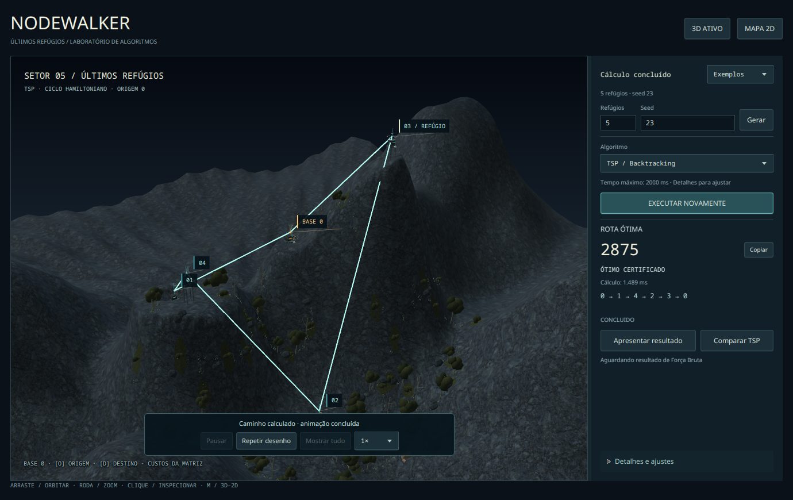
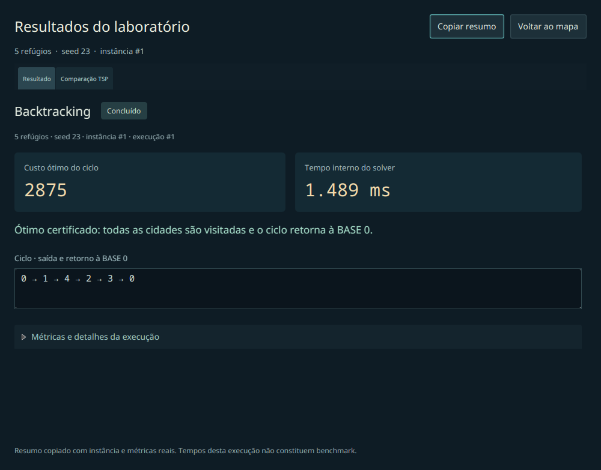
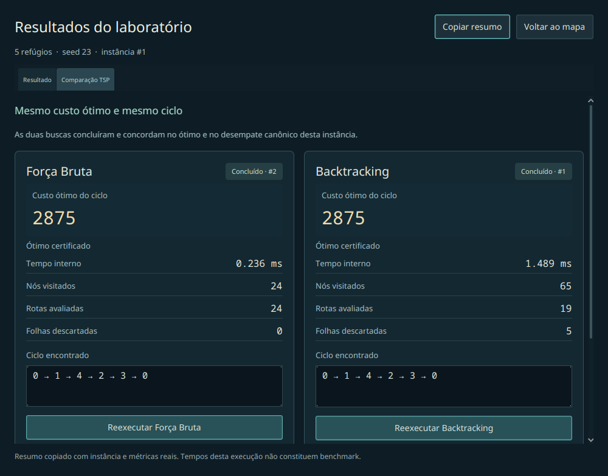
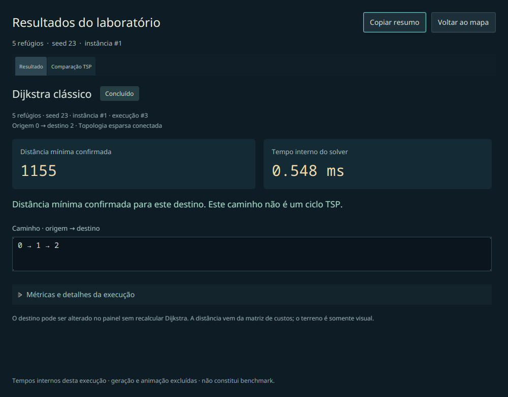

# Resultados e comparação — 20/10/2026

Capturas de janelas JavaFX reais no Fedora, com controles acionados por API e algoritmos
de produção. Não são mockups, fixtures de apresentação nem validação por entrada humana.
Os arquivos `environment.json`, `results-manifest.tsv`, `comparison-copy.txt` e `review.log`
de cada diretório registram ambiente, instância/execução, resposta e verificações.

## Fluxo para apresentar

1. Gere uma instância e execute o primeiro algoritmo normalmente.
2. **Apresentar resultado** destaca custo/distância, tempo interno, conclusão e ciclo/caminho.
   **Copiar resumo** copia texto com N, seed, identificadores e métricas reais.
3. **Comparar TSP** abre Força Bruta e Backtracking lado a lado. Execute o algoritmo faltante
   pelo cartão; a matriz e a geometria são preservadas. Durante trabalho, **Cancelar busca**
   está disponível e os botões de nova execução ficam desabilitados.
4. Mostre a conclusão da comparação. **Voltar ao mapa** ou Esc retorna à exploração.







## Respostas comprovadas

Mesma instância N=5, seed 23, origem TSP 0:

| Algoritmo | Estado | Custo | Sequência |
| --- | --- | --- | --- |
| Força Bruta | CONCLUIDO | 2875 | 0 → 1 → 4 → 2 → 3 → 0 |
| Backtracking | CONCLUIDO | 2875 | 0 → 1 → 4 → 2 → 3 → 0 |
| Dijkstra, esparsa conectada, seed 23, extras 0, destino 2 | CONCLUIDO | 1155 | 0 → 1 → 2 |
| Mesmo Dijkstra, destino 0 | CONCLUIDO | 0 | 0 |

As linhas Dijkstra são caminhos mínimos distintos do problema TSP. A troca de destino
conservou o objeto ShortestPathResult e runId; o relatório foi atualizado sem nova busca.
Tempos variam entre execuções e não constituem benchmark nem ranking de desempenho.



## Verificações gráficas

`--results` passou com o pipeline do desktop e com `--software-2d`. O roteiro verifica:

- abertura, cópia e fechamento do relatório;
- comparação inicialmente incompleta e execução do algoritmo faltante;
- uso da mesma matriz, compartilhamento do mundo preparado e seleção preservada;
- bloqueio de novas buscas simultâneas e cancelamento cooperativo disponível;
- concordância real dos dois solvers TSP;
- janela reduzida 700×500, com rolagem e botão de retorno dentro da área visível;
- relatório Dijkstra com distância confirmada, destino intermediário e origem=destino;
- substituição da instância removendo resposta e comparação antigas.

O roteiro histórico de presets/fixtures também passou (`legacy-review.log`), conservando
sua distinção entre resposta real e fixture. A regressão de reprodução visual passou
(`playback-regression.log`): pontos/arestas graduais, pausa, velocidade, repetição sem busca,
continuidade 3D/2D e invalidação ao gerar instância nova.

Há 14 novos testes headless dos modelos de relatório/comparação: limites exatos de valores,
BigInteger acima de long, custo zero e Long.MAX_VALUE, ausência de métricas, conclusão e
interrupção, origem=destino, inalcançabilidade, identificação de execuções, última tentativa,
isolamento por instância/problema e divergência do desempate canônico. A suíte local completa
passou com **2301 testes, zero falhas/erros/ignorados**; `git diff --check` também passou.
O CI Ubuntu/Windows permanece configurado; estes ajustes locais ainda não foram publicados
para disparar uma nova execução remota. Homologação humana da issue #13 permanece separada.

Reprodução:

```bash
python3 tools/review_world.py --results --output tsp-app/target/review-results
python3 tools/review_world.py --results --software-2d --output tsp-app/target/review-results-2d
python3 tools/review_world.py --playback --output tsp-app/target/review-results-playback
python3 tools/review_world.py --output tsp-app/target/review-results-legacy
```
