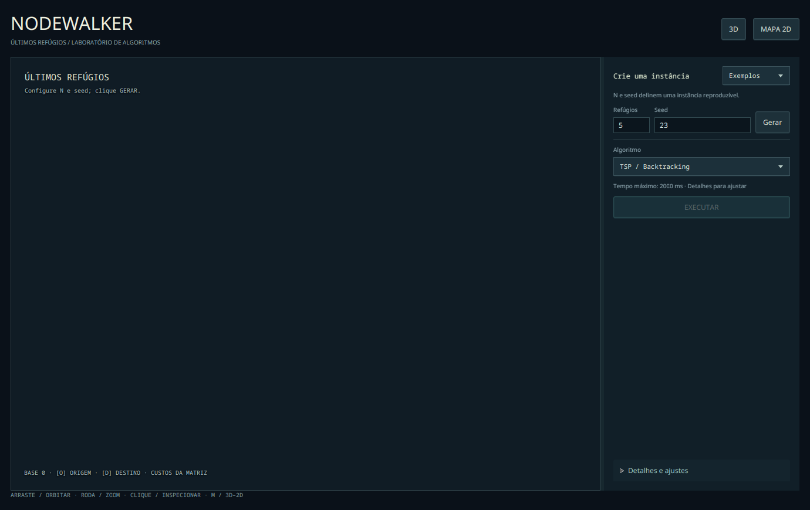
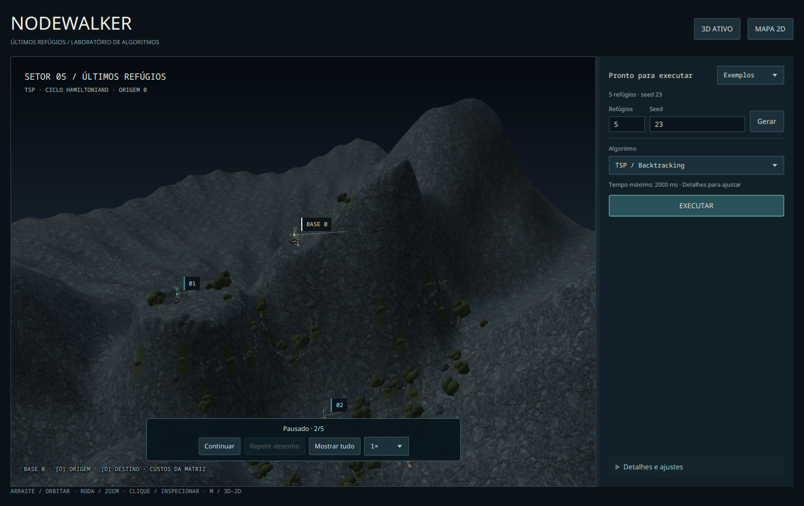
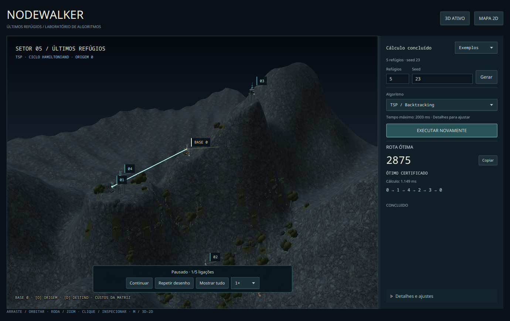
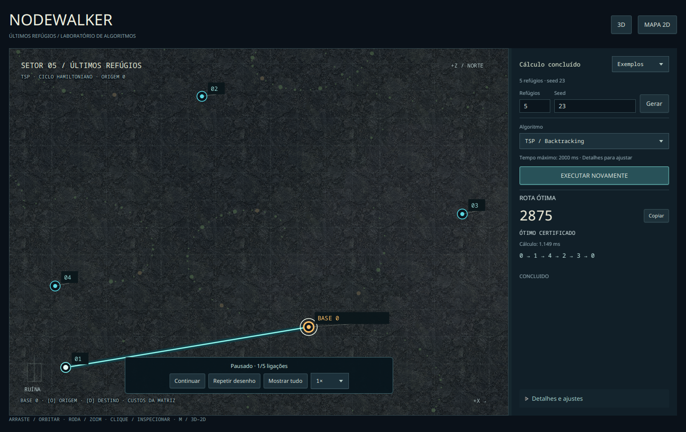
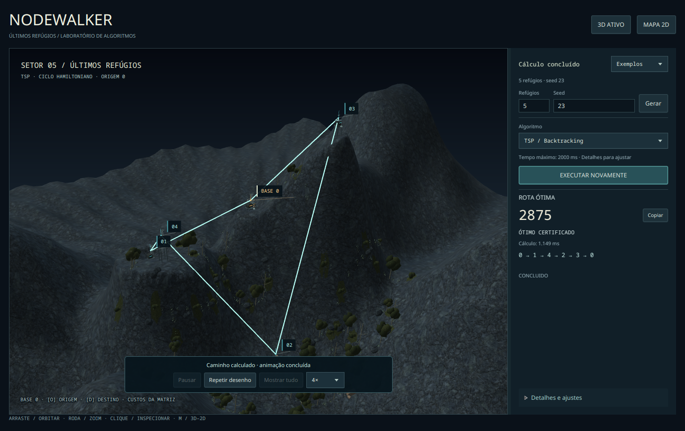
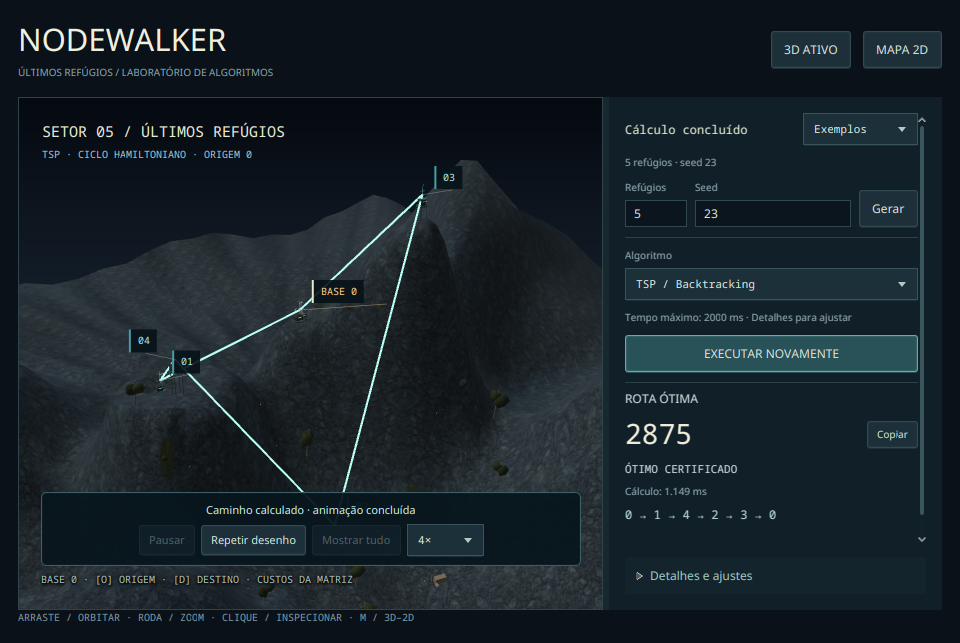

# HUD simplificado e reprodução gradual — 19/10/2026

Revisão após o usuário apontar excesso de seções e resultado visual instantâneo.
Capturas da aplicação real, sem edição, em Fedora 44 / JavaFX 21 / RTX 5060.
[Ambiente](desktop/environment.json) · [manifesto da animação](desktop/playback-manifest.tsv)
· [execução](desktop/review-output.txt).

O painel principal mantém N/seed, exemplos, algoritmo, executar e resposta compacta.
Os parâmetros técnicos, preflight, métricas, comparação, inspeção e exploração ficam em
uma única área **Detalhes e ajustes**. O acesso permanece visível na janela menor.
Caixas de resultado vazias foram retiradas do fluxo inicial.

A geração revela os refúgios progressivamente. Após o cálculo, o mapa reproduz as ligações
da resposta com marcador móvel, pausa/continuação, velocidade, repetição e mostrar tudo.
Essa é uma **animação da resposta**: não é um rastreamento dos estados da busca nem da
ordem de fixação de Dijkstra. O tempo interno do solver permanece real e separado.

## Capturas selecionadas

N=5, seed23, Backtracking real: custo 2875 e ciclo 0→1→4→2→3→0. O manifesto registra
CONCLUIDO junto de PATH/pausado/1 ligação completa, comprovando a separação entre o cálculo
já terminado e sua apresentação parcial. O cilindro da ligação em curso é conferido com
altura menor que o segmento completo dentro da SubScene real.

O teste também verificou que pausa congela a fração, 3D/2D preserva o ponto da reprodução,
repetir mantém resultado/runId/histórico sem nova busca e gerar outra instância remove
rota e animação anteriores. O resultado não é convertido em um TspResult de prefixo.

## Regressão

- [Fallback automático 2D](fallback/playback-manifest.tsv): mesma reprodução, Scene3D indisponível e botão 3D desabilitado.
- [Operação completa em 2D forçado](operacao-2d/operational-manifest.tsv): Força Bruta, Backtracking, Dijkstra completo/esparso, troca de destino/origem, cancelamento e fechamento durante busca.
- [Roteiro gráfico histórico](regressao/manifest.tsv): presets, câmera/seleção, qualidade, certificação e fixtures identificadas de apresentação.
- 14 testes headless novos para relógio/pausa/velocidade, filas de reprodução, limites de fração, endpoints, câmera/instância/resultado preservados e caminhos Dijkstra sem fechamento artificial.

Os roteiros usam controles por API e janelas reais; não são revisão humana ou medição de
FPS. A pendência anterior de entrada nativa no Wayland continua registrada no histórico.
