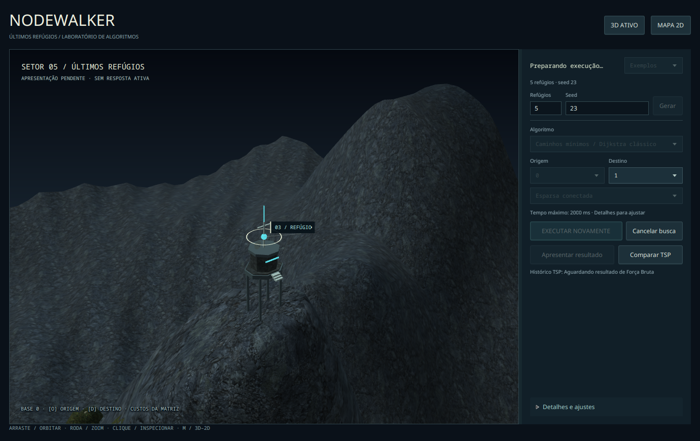
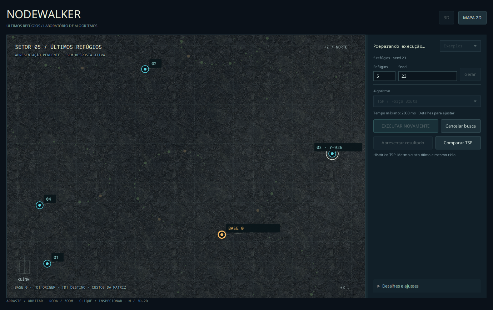
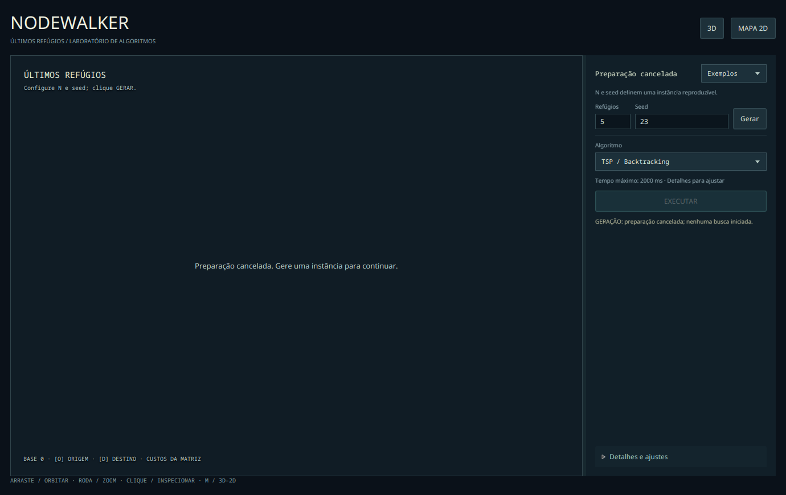
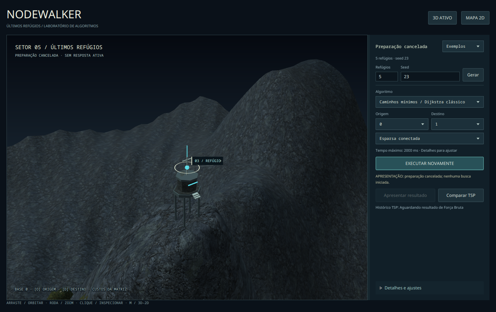
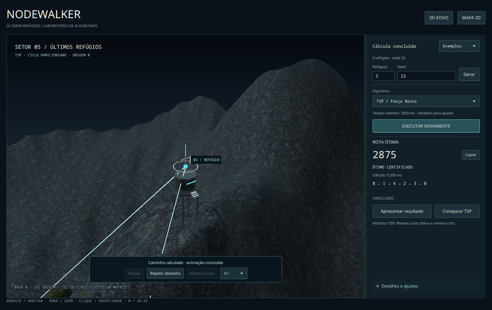

# Revisão da PR #36 — rota obsoleta e cancelamento de preparação

20/10/2026. Esta coleta complementa a [operação](../README.md), a
[reprodução visual](../simplificacao/README.md) e a [comparação](../resultados/README.md).
São janelas JavaFX reais, com controles por API, workers/callbacks deliberadamente retidos
e solvers de produção. Não há fixtures de resultados nem entrada humana nessa coleta.

## Remoção imediata da resposta anterior

`PendingSceneModel` referencia o mesmo PreparedWorld e expõe zero arestas destacadas/secundárias.
É publicado antes da preparação assíncrona nas trocas de configuração, reexecução e destino.
O mapa identifica **SEM RESPOSTA ATIVA**, retira rota/cursor/reprodução anteriores e preserva
terreno, câmera e seleção. Os dados históricos continuam identificados como histórico.

O roteiro mantém a instância N=5/seed23 e a seleção no refúgio 3, com câmera focada nele.
Verifica identidade da matriz, PreparedWorld, nó do terreno, SubScene/câmera e transformação
da câmera. As cenas do controlador e da view devem ser idênticas, sem segmentos antigos.

| Transição retida | Snapshot | Árvore gráfica 3D | Canvas 2D |
| --- | --- | --- | --- |
| Backtracking concluído → Dijkstra, antes dos workers | 0 segmentos | camada de rota vazia; cursor oculto | já coincide pixel a pixel com apresentação sem rota |
| Topologia pronta, apresentação ainda pendente | 0 segmentos | camada vazia | mesma verificação de pixels |
| Dijkstra concluído → Força Bruta | 0 segmentos | camada vazia | mesma verificação de pixels |
| Configuração substituída com callback antigo na UI | callback rejeitado; 0 segmentos | camada vazia | mesma verificação de pixels |
| TSP concluído → EXECUTAR NOVAMENTE | 0 segmentos | camada vazia | mesma verificação de pixels |
| Destino Dijkstra alterado, apresentação pendente | 0 segmentos; busca permanece em cache | camada vazia | mesma verificação de pixels |
| Instalação JavaFX antiga de arestas ainda enfileirada | revisão invalida a instalação | camada permanece vazia após drenar instalador | redesenho vazio verificado |

No 3D, a inspeção entra na raiz da SubScene e verifica o grupo `active-route-layer`, não
apenas o modelo ou o retorno de `lookup` da cena externa. No 2D, compara os pixels do Canvas
que já estava apresentado com uma renderização explicitamente sem caminho, na mesma
geometria/configuração; isso detecta uma camada que não tenha sido redesenhada.




## Cancelamento por etapa

Antes da geração efetiva, o roteiro solicita cancelamento e comprova ausência de instância,
resultado e cena. O mapa passa a dizer **Preparação cancelada**, sem continuar anunciando
que a geração está em andamento.



Preparação cancela o token cooperativo e invalida epoch/revisão, inclusive callbacks já
na UI. Publica explicitamente CANCELAMENTO SOLICITADO → CANCELADO. Não fabrica resultado
de solver, não admite uma instância ainda pendente e não volta a INSTÂNCIA PRONTA por uma
entrega atrasada. Um mundo já admitido é conservado para permitir repetir a preparação.

Busca TSP/Dijkstra mantém epoch/entrega e solicita somente os tokens do solver. A resposta
real decide o estado final e preserva incumbentes/distâncias confirmadas. Quando o solver
já produziu CONCLUIDO ou LIMITE_ATINGIDO antes do cancelamento tardio, esse estado permanece.
Uma apresentação pendente de resposta válida não é descartada por um cancelamento tardio.




O roteiro gráfico cancela exatamente com o callback de apresentação retido, drena essa
entrega e comprova que CANCELADO permanece sem resposta fabricada. EXECUTAR depois disso
refaz a preparação e executa Dijkstra real. Na reexecução TSP, retém a resposta já concluída
no callback da UI, solicita cancelar e comprova CONCLUIDO no final.

## Testes e reprodução

Foram adicionados **30 casos headless** em `OperationalTransitionsTest`, sem inicializar
JavaFX nem depender de display. Usam executores manuais, filas e CountDownLatch/Future como
barreiras, sem sleeps. Cobrem:

- A/B/C/D, callbacks antigos de resultado/configuração e revisões de destino;
- oito pontos de cancelamento entre geração/topologia/apresentação, com tarefas ou callbacks pendentes;
- geração, topologia e mundo em andamento, com barreiras e término cooperativo;
- cancelamento tardio antes/depois da entrega do solver, nos três algoritmos;
- respostas limitadas com incumbente ou distância confirmada e sem falso ótimo;
- retry da mesma configuração, inclusive cancelamento do retry com prontidão já na fila;
- identidade do mundo/grafo, preservação de navegação/geometria e ausência de caminho certificado durante preparação.

`mvn clean verify`, sem DISPLAY/WAYLAND_DISPLAY, passou com **2331 testes**, zero falhas,
erros ou ignorados: core2032 + CLI125 + app174. O core de produção e seus contratos não foram
alterados. [Log completo](headless-verify.txt). `git diff --check` também foi executado.

Os roteiros de transição passaram em 3D e 2D de software:

- [Manifesto 3D — todas as 17 etapas](desktop/transitions-manifest.tsv), [ambiente](desktop/environment.json), [resultado](desktop/review-output.txt).
- [Manifesto 2D — todas as 17 etapas](software-2d/transitions-manifest.tsv), [ambiente](software-2d/environment.json), [resultado](software-2d/review-output.txt).

As capturas selecionadas estão neste diretório; os manifestos enumeram também as outras
etapas verificadas/capturadas pelo roteiro. A regressão adicional passou em
[operação 3D](operational-3d/review-output.txt), [operação 2D](operational-2d/review-output.txt),
[reprodução](playback/review-output.txt), [resultados/comparação](results/review-output.txt)
e [presets/fixtures históricos](legacy/review-output.txt).

```bash
python3 tools/review_world.py --transitions --output tsp-app/target/review-transitions
python3 tools/review_world.py --transitions --software-2d --output tsp-app/target/review-transitions-2d
```

A retenção opcional permanente de uma tentativa por algoritmo não foi incluída: permanece
o histórico de oito respostas. **Entrada humana de mouse/teclado segue pendente**; a
limitação histórica do Robot no Wayland continua documentada, sem ser promovida a aprovação.
Esta revisão não inicia a homologação da issue #13 e não autoriza merge automático.
