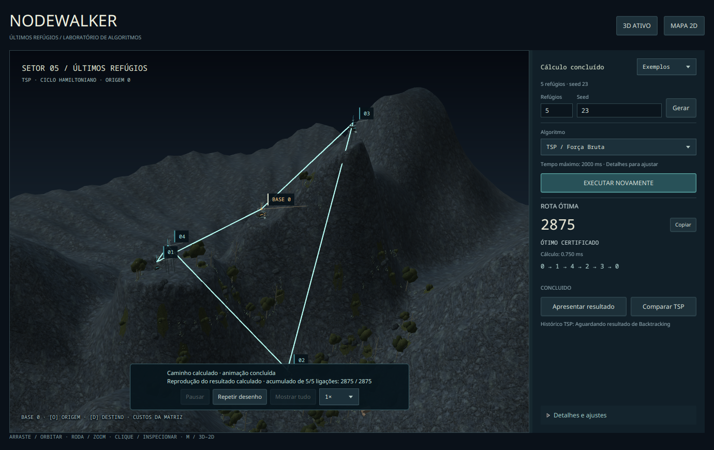
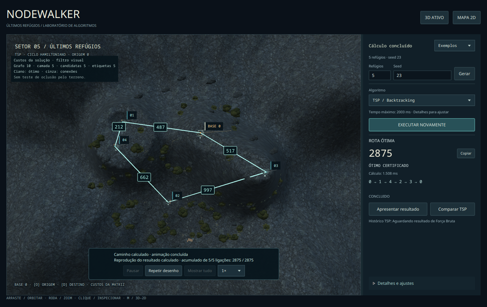
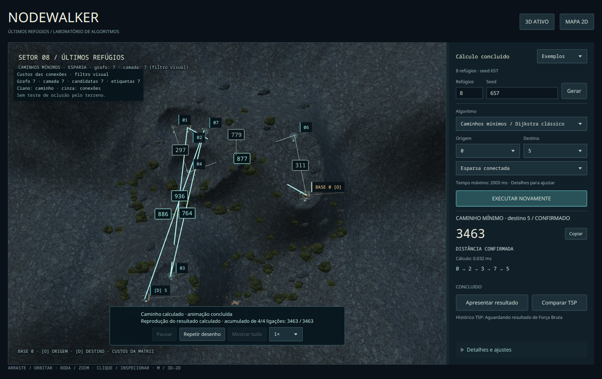
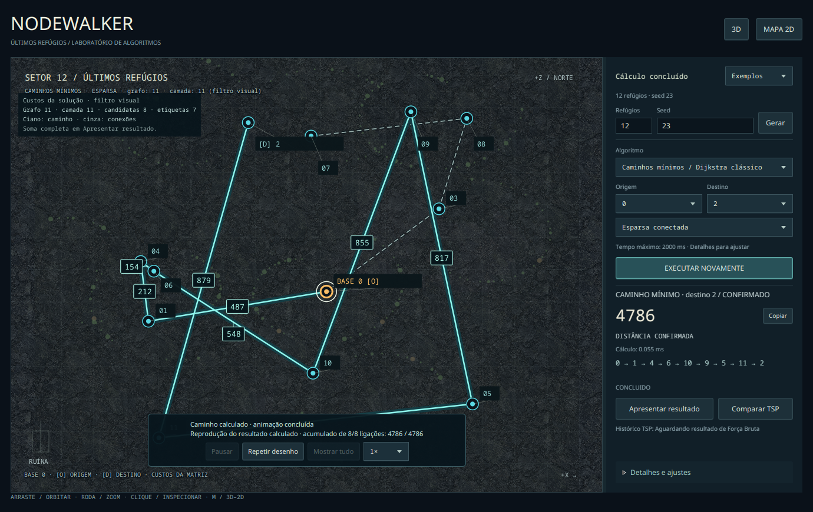

# Evidências da validação #13 — 21/10/2026

[Relatório e matriz de aceite](../../VALIDACAO_MVP.md) · [roteiro acadêmico](../../DEMONSTRACAO_ACADEMICA.md) · [benchmark e dados](../../benchmarks/issue-13/README.md).

**Produto de referência:** main `9c23bb6bc914b6be563a16e1ad0b2ae1cfe0d80c` (PR #37). **Ambiente:** Fedora 44/Wayland, JDK 21, JavaFX 21.0.12. [Inventário](environment.json). Esta coleta prova testes e janelas automatizadas; não prova interação humana física nem abertura de janela Windows.

## Fontes e integridade da coleta

| Artefato | O que comprova |
| --- | --- |
| [main-verify.json](main-verify.json), [saída](main-verify.txt) | Novo baseline da main, exit0; não reutiliza a aprovação anterior da PR #37 |
| [final-verify.json](final-verify.json), [saída final](final-verify.txt) | Repetição final sem DISPLAY/WAYLAND_DISPLAY, 2373 testes, exit0; checks do SHA da PR registrados separadamente na publicação |
| [test-summary.json](test-summary.json) | 2373 execuções: core2032, CLI125 e app216, todas sem falha/erro/ignorado; extraído dos relatórios do clone |
| [clone/commands.json](clone/commands.json) | Comandos/cwd/data/duração/exit code do clone remoto, verify/install/CLI e JavaFX |
| [clone/08-javafx-default/PASS.txt](clone/08-javafx-default/PASS.txt), [2D](clone/09-javafx-2d/PASS.txt) | Verificações funcionais do aplicativo original no clone; custo2875, ciclo0–1–4–2–3–0, tabela e troca de modo |
| [graphics/commands.json](graphics/commands.json) | Todos os 15 roteiros da bateria isolada: 14 obrigatórios exit0 e tentativa Robot exit1 |
| [academic-reference.txt](academic-reference.txt) | Solvers reais: exemplo do professor, valores da demonstração, MAX, BigInteger, inalcançável e limite sem falsa certificação |
| [threads.json](threads.json) | Stacks/threads e avaliações do debugger: geração, BF, BT e Dijkstra fora da FX Thread; geometria no worker de apresentação |
| [asset-hashes.json](asset-hashes.json) | Dois PNGs locais preservados, hashes correspondentes à documentação de origem |
| [incidents/](incidents/) | Primeira falha de classpath, mudança de câmera observada no debugger e comandos anteriores; não foram apagados os insucessos |

PNGs são snapshots reais não editados. Os logs de texto tiveram somente espaços finais removidos para satisfazer `git diff --check`; nomes `*.log` foram copiados como `*.txt`. A seleção de capturas é menor que a coleta temporária completa; manifestos preservam também verificações cujos PNGs não foram versionados. Valores de tempo/heap/RSS nos manifestos são amostras do método original, não FPS da GPU ou memória estabilizada.

## Clone remoto limpo

O ensaio criou `/tmp/nodewalker-issue13-qbtczis8/repo` por clone remoto e `/tmp/nodewalker-issue13-qbtczis8/m2` vazio. Settings de usuário e global substituídos pelo [arquivo vazio](clone/empty-settings.xml); sem copiar `target`, classes, artefatos NodeWalker ou configuração da IDE. O diretório temporário é uma localização da coleta, não caminho obrigatório para reproduzir.

Comandos reproduzíveis e explicação do agente: [relatório](../../VALIDACAO_MVP.md#clone-limpo-método-e-resultados). O teste abriu a main class original usando `mvn -f tsp-app/pom.xml javafx:run`. Um javaagent **sem transformação de bytecode**, compilado contra esse clone, acionou controles por API e observou a janela. N5/seed23 foi gerado, BF executou, ciclo/custo e tabela apareceram, 3D/2D preservou a resposta e a janela fechou pelo evento normal, Maven exit0. A execução explícita `--2d` repetiu o fluxo. O agente não integra os JARs do produto, não altera o solver e não representa entrada humana.



[Mesma resposta em 2D](clone/08-javafx-default/02-tsp-2d.png) · [cinco termos com retorno](clone/08-javafx-default/03-full-result-table.png) · [entrada explícita 2D](clone/09-javafx-2d/01-tsp-result-2d.png).

## Bateria gráfica isolada

Para evitar concorrência com targets da IDE, os roteiros foram reexecutados num checkout independente em `bbf56d2`: produção idêntica à main9c23bb6, utilitários de validação e proteção **somente de teste** contra InputEvent externo no cenário de transições. Não confundir esse checkout com o clone remoto limpo acima.

```bash
python3 tools/run_mvp_graphics.py --checkout /caminho/checkout-isolado --maven-repo /caminho/m2-temporario --settings /caminho/empty-settings.xml --output /tmp/nodewalker-graphics-novo
```

Usar o checkout desta branch/PR; o repositório Maven precisa conter o core instalado pelo build isolado. Desktop Linux necessário. O wrapper executa cada roteiro sequencialmente, com timeout, e registra exit codes; o Robot opcional não é convertido em PASS. Um único comando `--weights` ou `--operational` em `tools/review_world.py` também pode ser usado, conforme os comandos exatos do manifesto.

| Roteiro | Resultado | Método e alcance |
| --- | --- | --- |
| [world-3d](graphics/world-3d/review.txt) | PASSOU | Câmera/zoom/foco/seleção via eventos/API; catálogo e fixtures explicitadas no manifesto |
| [world-fallback](graphics/world-fallback/review.txt) | PASSOU | Pipeline software, feature SCENE3D=false, início automático no Canvas |
| [operational-3d](graphics/operational-3d/review.txt), [2d](graphics/operational-2d/review.txt), [fallback](graphics/operational-fallback/review.txt) | PASSOU (3) | Instâncias N3/5/8/12, três solvers reais, cancelamento, comparação, resize e fechamento durante busca |
| [transitions-3d](graphics/transitions-3d/review.txt), [2d](graphics/transitions-2d/review.txt) | PASSOU (2) | Workers/UI manuais e barreiras; callbacks já enfileirados, cancelamento de preparação e ausência de rota antiga |
| [weights-3d](graphics/weights-3d/review.txt), [2d](graphics/weights-2d/review.txt), [fallback](graphics/weights-fallback/review.txt) | PASSOU (3) | Solvers reais N5/8/12, custos, filtros, tabelas, projeção, colisões, reprodução e invalidação |
| [playback-3d](graphics/playback-3d/review.txt), [2d](graphics/playback-2d/review.txt) | PASSOU (2) | Reprodução/pausa/acumulado; inclui fixtures de apresentação identificadas, não estados observados de busca |
| [results-3d](graphics/results-3d/review.txt), [2d](graphics/results-2d/review.txt) | PASSOU (2) | Relatórios, comparação e janelas de resultados de solvers reais |
| [robot-attempt](graphics/robot-attempt/review.txt) | FALHOU / inconclusivo para homologação nativa | Robot não conseguiu mover câmera no Wayland disponível. Não é interação humana; método físico permanece PENDENTE |

`--software-2d` é modo 2D explícito sob software. `--software-auto` não solicita 2D: a ausência da feature Scene3D no pipeline força a seleção automática. Isso não prova comportamento de outro hardware/driver sem 3D nem recuperação após uma exceção real de criação do renderer, que não ocorreu nesta coleta.

### Custos e leitura do grafo







Outras verificações visuais:

- [N5: aba Mapa escura e legenda compacta em 2D](graphics/weights-3d/n5-dark-map-details-compact-legend.png).
- [N8: tabela completa de Dijkstra, 877+936+764+886=3463](graphics/weights-3d/n8-dijkstra-full-table-real.png).
- [N8: topologia completa com filtragem gráfica](graphics/weights-3d/n8-dijkstra-complete-connections-3d.png).
- [N12: decomposição TSP e aresta de retorno](graphics/weights-3d/n12-tsp-table-return-edge.png).
- [N12: cancelamento real com incumbente não certificada](graphics/operational-3d/08-n12-cancelled-incumbent-real.png). O custo depende do instante do cancelamento.
- [N12: janela pequena e simplificação](graphics/operational-3d/09-n12-small-window-simplified-real.png).
- [Nova execução com workers retidos: resposta anterior removida](graphics/transitions-3d/09-rerun-workers-held.png). Cenário determinístico de teste.
- [Pausa após um segmento](graphics/playback-3d/03-one-edge-drawn-paused.png). Fixture de apresentação; não é captura de busca interna.
- [Vista superior e seleção N5](graphics/world-3d/02-n5-top-selection.png).

O overlay 3D não testa oclusão pelo terreno. Rótulos podem ser omitidos por colisão/perspectiva; a tabela tem todos os termos independentemente do filtro. Não se alteraram matriz, XYZ, topologia lógica ou algoritmo para produzir as capturas.

## Pendências explicitamente preservadas

Interação física no Fedora: **PENDENTE**, usar o [checklist curto](../../VALIDACAO_MVP.md#checklist-humano-fedora). Windows desktop: **PENDENTE**, usar o [roteiro da #17](../../VALIDACAO_MVP.md#roteiro-windows--issue-17). Ubuntu/Windows CI validam build/testes headless, não essas janelas. Sem merge/encerramento automático; sem Modo Aula ou grafo dirigido nesta entrega.
