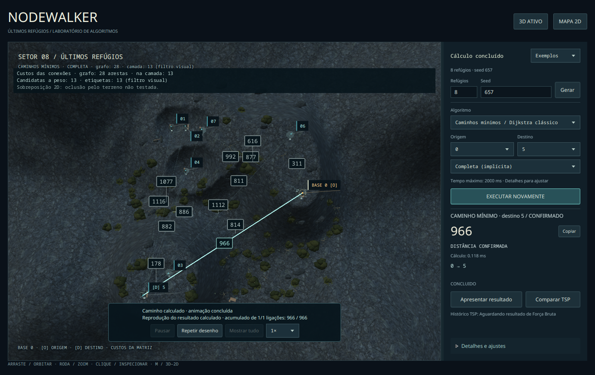

# Evidências Fedora — pesos e decomposição

Coleta em **20/10/2026**, branch `feat/didactic-edge-weights`, baseada no merge `627de81f`. Imagens PNG reais da janela JavaFX, sem montagem, desenho externo ou alteração de pixels. Ambiente: Fedora 44 / Wayland, Temurin 21.0.12.1, JavaFX 21.0.12, NVIDIA RTX 5060. Detalhes em [environment.json](environment.json).

**Método:** controles JavaFX/API acionados por roteiro automatizado, `Scene.snapshot` após barreiras de pulsos; comparação com a árvore gráfica efetiva, Canvas e transformação da câmera. Geração e solvers reais, sem fixtures de resultado nesta coleta de pesos. Não houve homologação manual de entrada humana de mouse/teclado; essa pendência permanece explícita. Capturas não constituem benchmark de FPS ou memória, nem homologação completa da #13.

## Ajuste de contraste das conexões

Após a revisão visual, as conexões secundárias receberam traço mais claro e espesso. Em 2D, contorno escuro, opacidade 90%, largura 1,8 px e tracejado 8/5 preservam leitura sobre o terreno; o caminho continua ciano/âmbar em primeiro plano. Em 3D, um material próprio com autoiluminação cinza e raio 1,1 substitui o aço escuro de raio 0,5, sem alterar os materiais dos refúgios. Capturas posteriores: [TSP 2D](contraste/n5-tsp-connections-2d.png), [Dijkstra completo 3D](contraste/n8-dijkstra-complete-connections-3d.png). [Manifesto](contraste/weights-manifest.tsv) e [log](contraste/review.txt). As capturas originais abaixo são preservadas como histórico.

## Cenas

| Instância | TSP — pesos da solução 3D | TSP — conexões ponderadas 2D | Dijkstra — conexões esparsas 3D | Dijkstra — pesos do caminho 2D |
| --- | --- | --- | --- | --- |
| N=5, seed 23 | [3D](n5-tsp-solution-3d.png) | [2D](n5-tsp-connections-2d.png) | [3D](n5-dijkstra-connections-3d.png) | [2D](n5-dijkstra-solution-2d.png) |
| N=8, seed 657 | [3D](n8-tsp-solution-3d.png) | [2D](n8-tsp-connections-2d.png) | [3D](n8-dijkstra-connections-3d.png) | [2D](n8-dijkstra-solution-2d.png) |
| N=12, seed 23 | [3D](n12-tsp-solution-3d.png) | [2D](n12-tsp-connections-2d.png) | [3D](n12-dijkstra-connections-3d.png) | [2D](n12-dijkstra-solution-2d.png) |

Todas as quantidades matemáticas/visuais estão no [manifesto](weights-manifest.tsv). Seeds de topologia e opções são configuradas pelo roteiro versionado `WeightsVisualReview`; topologias esparsas desta coleta usam seed 23 e nenhuma conexão extra. O destino escolhido maximiza o número de segmentos do resultado para favorecer a leitura de caminhos intermediários.



No grafo completo N=8, o solver considera **28 arestas**. O filtro do mapa seleciona 13 ligações e desenha 13 etiquetas nesta pose. O resultado 0→5, custo 966, continua usando o grafo completo, sem retorno artificial. [Esparso da mesma instância](n8-dijkstra-connections-3d.png) tem 7 arestas e caminho até 5 com quatro segmentos/custo 3463. São problemas de disponibilidade diferentes, explicitamente identificados.

## Decomposição e comparação reais

- TSP: tabelas completas [N=5](n5-tsp-full-table-real.png), [N=8](n8-tsp-full-table-real.png) e [N=12](n12-tsp-full-table-real.png). A [rolagem até o retorno de N=12](n12-tsp-table-return-edge.png) mostra a última aresta 10→0, peso 240 e acumulado 5417. A tabela contém 12 itens, mesmo quando nem todos cabem simultaneamente na janela.
- Dijkstra: [tabela N=8](n8-dijkstra-full-table-real.png), caminho 0→2→3→7→5, pesos 877+936+764+886=3463. Não contém retorno à origem.
- [Comparação real em N=5](n5-both-tsp-algorithms-real.png): Força Bruta e Backtracking usam o mesmo objeto `TspProblem`, concluem com custo 2875 e mesmo ciclo canônico. Nenhuma comparação de custo TSP × Dijkstra é produzida.
- N=8 Backtracking concluiu com custo 3574. N=12 Backtracking atingiu o orçamento de nós, preservando a incumbente 5417 **sem certificado de ótimo**. Esses valores são evidência das execuções registradas; o orçamento de tempo também pode interromper mais cedo em outra máquina. Força Bruta não foi executada em N=12 nesta coleta de pesos.
- [Reprodução pausada com segmento parcial](n5-replay-partial-zero-accumulation.png): acumulado 0/2875. Somente segmentos inteiros contribuem; pausar, repetir e alternar 3D/2D mantêm a identidade da execução e não chamam os solvers.

## Colisões e invalidação

- [Janela menor/densidade](n12-density-overlap-filter.png), 960×643 de conteúdo: candidatos excedem etiquetas, sem colisão entre custos. [Filtro incidente ao refúgio 3](n12-incident-selection-filter.png) preserva as arestas da solução.
- [Reexecutar: sem custos antigos](n12-rerun-no-old-costs.png): captura ocorre sincronamente depois de EXECUTAR, antes da publicação de novo resultado; frame sem candidatas, sem etiquetas e sem decomposição anterior.
- O roteiro confere custos originais, existência na topologia, limites de tela, não sobreposição de custos e dos Labels reais dos refúgios 3D. A projeção é comparada com a inversa da transformação da **PerspectiveCamera efetiva**, viewport e FOV. Os testes headless também verificam clipping/zoom/órbita/redimensionamento e prioridade dos obstáculos.
- **Não há teste de profundidade para oclusão pelo terreno:** a legenda informa essa limitação. Uma etiqueta no viewport não garante que a aresta 3D esteja fisicamente descoberta.

## Execuções adicionais

| Roteiro | Evidência | Resultado |
| --- | --- | --- |
| Pesos 3D/2D | [log](review.txt), [manifesto](weights-manifest.tsv) | PASS; 23 capturas reais |
| Pesos com `--software-2d` | [log](2d/review.txt), [manifesto](2d/weights-manifest.tsv), [captura](2d/n8-tsp-connections-2d.png) | PASS; Prism software, Canvas 2D |
| Pesos com `--software-auto` | [log](fallback/review.txt), [ambiente](fallback/environment.json), [captura](fallback/n8-dijkstra-connections-2d.png) | PASS; fallback automático sem Scene3D |
| Operacional anterior 3D/2D | [3D](operational/review.txt), [2D](operational-2d/review.txt) | PASS; solvers reais, cancelamento com incumbente |
| Transições anteriores 3D/2D | [3D](transitions/review.txt), [2D](transitions-2d/review.txt) | PASS; filas/barreiras, apresentação pendente, cancelamento de preparação e tardio |
| Reprodução anterior | [log](playback/review.txt) | PASS; inclui fixtures de apresentação identificadas no roteiro/manifesto |
| Resultados/comparação anteriores | [log](results/review.txt) | PASS; resultados algorítmicos reais |

Foram preservados logs/manifestos dos roteiros anteriores, sem duplicar aqui suas capturas. As cenas desta página são exclusivamente resultados reais; a existência de fixtures no roteiro de reprodução anterior não transforma os exemplos desta coleta em fixtures.

## Reprodução da coleta

```bash
python3 tools/review_world.py --weights --output tsp-app/target/review-weights
python3 tools/review_world.py --weights --software-2d --output tsp-app/target/review-weights-2d
python3 tools/review_world.py --weights --software-auto --output tsp-app/target/review-weights-fallback
```

JDK 21, Python 3, dependências JavaFX locais e desktop nativo são necessários. O CI Ubuntu/Windows executa os testes headless; não abre janela nem substitui a revisão gráfica Fedora. Os 42 novos casos headless elevam a suíte de 2331 para **2373** (2032 core, 125 CLI e 216 app), com zero falhas/erros/ignorados em `mvn clean verify` local. Não houve alteração dos algoritmos ou contratos do core.
